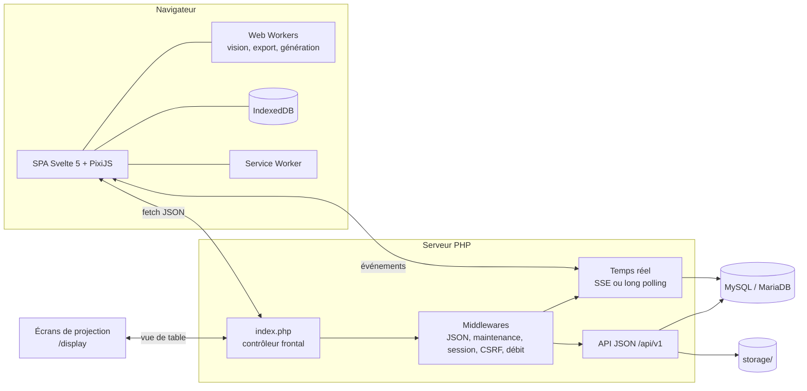

# Clairvoie

Outil web pour construire, révéler et projeter des cartes de jeu de rôle, en ligne ou autour de la table, sur un hébergement PHP/MySQL ordinaire.

*Une clairvoie est une ouverture dans un mur qui laisse passer le regard : murs, lumière et vision sont au cœur de l'outil. Le dépôt et les archives gardent leur nom technique `JDR` / `jdr-…`.*

[](https://github.com/collet-david-pro/JDR/releases)
[](LICENSE.md)


> [!WARNING]
> **Version alpha `0.1.0-alpha.1`.** Première release publique, utilisable pour des essais entre amis. Il n'y a pas encore de revue de sécurité complète, et l'installation n'a pas encore été éprouvée sur un grand nombre d'hébergeurs. Des changements incompatibles sont possibles avant la version stable.

## Sommaire

- [Présentation](#présentation)
- [Fonctionnalités](#fonctionnalités)
- [Démarrage rapide](#démarrage-rapide)
- [Prérequis](#prérequis)
- [Installation](#installation)
- [Mise à jour](#mise-à-jour)
- [Sécurité](#sécurité)
- [Architecture](#architecture)
- [Développement](#développement)
- [Feuille de route](#feuille-de-route)
- [Documentation](#documentation)
- [Contribuer](#contribuer)
- [Licence](#licence)
- [Auteur](#auteur)

## Présentation

### Le problème

Un maître de jeu (MJ) prépare des cartes, puis doit les montrer à ses joueurs : à distance, sans leur révéler ce qu'ils ne doivent pas voir, ou en présentiel, à l'échelle des figurines. Clairvoie répond à ce besoin : le MJ dessine ses maps, les range par partie et les projette.

### Pour qui

- **Le MJ** construit ses maps, les organise par partie, puis les projette. Il place des murs, des portes, des lumières et des tokens. Les joueurs ne voient que ce qu'ils explorent.
- **Les joueurs** rejoignent la séance avec un code, dans leur navigateur.
- **En présentiel**, un écran posé sur la table (tablette, télévision, vidéoprojecteur) affiche la map à l'échelle réelle, pour y poser de vraies figurines.
- **L'administrateur du site** installe et met à jour l'outil sur son hébergement.

### Ce que l'outil n'est pas

Clairvoie n'est **pas un VTT de règles** : pas de dés, pas d'initiative, pas de fiches de personnage, pas de points de vie. L'outil sert à la carte, pas aux règles.

### Principes

- **Hébergement simple** : PHP et MySQL ou MariaDB, sans démon, sans WebSocket, sans Composer en production. On envoie les fichiers, puis on ouvre `install.php`.
- **Données chez soi** : les comptes, les maps et les images restent sur votre hébergement.
- **Édition hors ligne** : l'éditeur fonctionne sans connexion, les modifications sont mises en file d'attente puis synchronisées.
- **Projection en présentiel** : des écrans sans compte, appairés à la séance, affichent la vue de table à l'échelle réelle.

## Fonctionnalités

Le détail complet, phase par phase, est dans le [CHANGELOG](CHANGELOG.md).

<!-- captures d'écran à venir -->

### Éditeur de maps

- Grille carrée, calques, tuiles par blocs, pinceau, gomme, remplissage, formes, sélection, pipette, règle, annuler et rétablir.
- Enregistrement automatique avec file d'attente hors ligne (IndexedDB) : une coupure réseau ou un onglet fermé brutalement ne fait pas perdre les modifications.
- Historique de versions restaurable, export et import JSON ou ZIP (images incluses), onglet Maps avec dossiers, duplication et corbeille.
- Export PNG en flux : haute résolution, fond transparent, mode impression (A4, A3, Letter).
- Rendu WebGPU, avec repli WebGL2.

### Murs, lumière, vision et brouillard

- Murs en polyligne ou par pièce, avec aimantation. Portes (ouvrables, verrouillées, secrètes) et fenêtres.
- Lumières préréglées (torche, lanterne, bougie, feu de camp, lumière magique) : couleur, vacillement, cônes.
- Lumière et vision arrêtées par les murs, calculées dans un Web Worker. Ambiance (obscurité, teinte, cycle jour et nuit) et ombres portées.
- Brouillard de guerre explorable, enregistré sur le serveur. Outil Révéler/masquer. Vue « comme le joueur ».

### Génération procédurale

- Quatre générateurs déterministes : donjons, grottes, extérieurs (biomes, rivières, routes, ponts et gués) et villages.
- Une graine reproductible : la même graine redonne la même map. Préréglages, aperçu, progression et annulation.
- Génération dans une nouvelle map, dans la map actuelle ou dans une sélection (donjon, grotte). Une seule commande « annuler » défait tout.
- Textures raccordables, à enregistrer dans la bibliothèque. Pack de base de 39 images installé automatiquement.
- Détails : [docs/procgen.md](docs/procgen.md).

### Séances en ligne

- Le MJ lance une séance. Les joueurs la rejoignent avec un code sur `/join`.
- Lobby avec préchargement, console du MJ (joueurs, affectations, tokens, révélations, ambiance, notes, maps), vue joueur.
- Pause, textes à lire à voix haute, expulsion d'un joueur.
- Temps réel sans WebSocket : flux SSE, puis long polling, puis polling court, avec bascule automatique selon l'hébergement.
- Brouillard strict (`fog_strict`, actif par défaut) : le serveur filtre ce que chaque joueur reçoit. Les tokens cachés et les objets réservés au MJ ne lui sont jamais envoyés.
- Détails : [docs/realtime.md](docs/realtime.md).

### Mode présentiel

- Des écrans de projection se branchent à la séance avec un code à 6 chiffres ou un QR code. Aucun compte à créer.
- L'écran ne montre que la vue de table, calculée par le serveur.
- Échelle réelle (25 mm par case par défaut), calibrée à la diagonale ou à la règle. Rotation, miroir, pilotage de la caméra, verrou de vue.
- Jusqu'à 8 écrans par séance. Révocation immédiate.
- Détails : [docs/irl.md](docs/irl.md).

### Bibliothèque d'images

- Import par glisser-déposer (PNG, JPEG, WebP, GIF, WebP animés).
- Contrôle strict des fichiers : type réel, dimensions, fichiers piégés refusés, ré-encodage, miniatures.
- Quotas, déduplication, catégories, tags, favoris, bibliothèque générale, packs ZIP.

### Parties, membres, tokens et rencontres

- Parties : création, archivage, corbeille. Membres et co-MJ.
- Définitions de tokens avec image, taille, vision et lumière. Rencontres préparées à l'avance.
- Cloisonnement strict des données entre les parties.

### Administration, sécurité et mise à jour

- Installeur web en 6 étapes, qui reprend là où il s'est arrêté.
- Comptes : inscription ouverte, fermée ou sur invitation ; connexion, « se souvenir de moi », réinitialisation de mot de passe (SMTP optionnel), export et suppression des données personnelles.
- Console d'administration : comptes, quotas, invitations, réglages, e-mail de test, diagnostic, journal d'audit, migrations, mise à jour.
- Interface en français, thème clair, sombre ou automatique, trois styles (moderne, fantasy, science-fiction).

## Démarrage rapide

1. Téléchargez `jdr-v0.1.0-alpha.1-full.zip` depuis la [page des releases](https://github.com/collet-david-pro/JDR/releases/tag/v0.1.0-alpha.1) et décompressez-le.
2. Envoyez **tout le contenu** du dossier dans le dossier web de votre hébergement (souvent `www/` ou `public_html/`), fichiers cachés compris.
3. Créez une base MySQL ou MariaDB dans le panneau de l'hébergeur, et notez serveur, port, nom, utilisateur et mot de passe.
4. Ouvrez `https://votre-site/install.php` et suivez les 6 étapes : prérequis, base de données, site, administrateur, installation, fin.
5. Connectez-vous, créez une partie, puis une map.

## Prérequis

| Élément | Exigence |
|---|---|
| PHP | 8.1 ou plus récent |
| Extensions PHP obligatoires | `pdo_mysql`, `mbstring`, `json`, `fileinfo`, `gd`, `zlib`, `openssl`, `ctype`, `session` |
| Extensions facultatives | `imagick`, `apcu`, `zip`, `sodium` |
| Base de données | MySQL 5.7 ou plus, ou MariaDB 10.3 ou plus ; moteur InnoDB ; jeu de caractères `utf8mb4` |
| Droits de l'utilisateur de la base | `SELECT`, `INSERT`, `UPDATE`, `DELETE`, `CREATE`, `ALTER`, `INDEX`, `REFERENCES`, `DROP` |
| Serveur web | Apache (fichiers `.htaccess`), LiteSpeed, ou Nginx ([docs/nginx.md](docs/nginx.md)) |
| Conseillé | HTTPS ; `memory_limit` de 128 Mo ou plus ; `upload_max_filesize` et `post_max_size` de 10 Mo ou plus |

La réécriture d'adresses (`mod_rewrite`) est conseillée mais pas obligatoire.

Le développement demande en plus Node.js 20.19 ou plus (22 LTS conseillé). Node ne sert qu'à construire le front : il n'est pas requis en production.

## Installation

Le guide complet, avec le dépannage, est dans [docs/installation.md](docs/installation.md).

### Hébergement mutualisé (Apache)

Suivez le [démarrage rapide](#démarrage-rapide). Points d'attention :

- Affichez les fichiers cachés dans votre client FTP (FileZilla, par exemple) : les fichiers `.htaccess` doivent être envoyés.
- L'assistant peut créer la base si l'utilisateur en a le droit.
- Une fois l'installation terminée, supprimez `install.php` par FTP si l'assistant ne l'a pas fait. Il reste de toute façon verrouillé tant que `config.php` existe.
- Si le dossier du site n'est pas inscriptible, l'assistant affiche le contenu de `config.php` à copier à la main.

### Nginx

Nginx ne lit pas les `.htaccess` : les protections et la réécriture doivent être reproduites dans la configuration du serveur. Un exemple complet (PHP-FPM, flux temps réel, cache des assets, dossiers privés) est fourni dans [docs/nginx.md](docs/nginx.md). Si vous ne pouvez pas modifier cette configuration, installez en [mode sans réécriture](#mode-sans-réécriture) et vérifiez la protection des dossiers privés avec le diagnostic de l'installeur.

### YunoHost

Sur YunoHost, avec l'application **My Webapp** servie sous un sous-chemin (par exemple `/jdr/`), il faut ajouter un fichier de protection dans le dossier `<app>.d/` de la configuration Nginx de l'application, puis recharger Nginx :

```nginx
# /etc/nginx/conf.d/<domaine>.d/<app>.d/00-jdr-protect.conf
location ~ ^/jdr/(app|migrations|storage|i18n)(/|$) { deny all; }
location = /jdr/config.php    { deny all; }
location = /jdr/manifest.json { deny all; }
```

```bash
sudo nginx -t && sudo systemctl reload nginx
curl -sI https://<domaine>/jdr/app/bootstrap.php   # doit répondre 403
```

Le pas à pas complet, y compris le flux temps réel direct, est dans [docs/yunohost.md](docs/yunohost.md).

### Mode sans réécriture

Si `mod_rewrite` n'est pas disponible, Clairvoie fonctionne quand même : l'API est appelée en `index.php?r=/api/v1/…` et les pages utilisent des adresses de la forme `https://votre-site/#/games/12`. Le mode est enregistré dans `config.php` (`'routing_mode' => 'query'`). Si la réécriture devient disponible plus tard, remplacez la valeur par `'rewrite'`.

### Tâches planifiées (facultatif)

Sans cron, les tâches de fond (purges, corbeille, rotation des journaux…) s'exécutent pendant la navigation. Si votre hébergeur propose des tâches planifiées, appelez toutes les 5 minutes l'adresse affichée à la fin de l'installation :

```text
https://votre-site/cron.php?key=VOTRE_CLE_CRON
```

La clé est la valeur `cron_key` de `config.php` ; gardez-la secrète. En ligne de commande : `php cron.php --key=VOTRE_CLE_CRON`.

### Vérification après installation

Remplacez `jdr.example.org` par votre domaine :

```bash
curl -i https://jdr.example.org/api/v1/health                 # 200
curl -i 'https://jdr.example.org/index.php?r=/api/v1/health'  # 200 (mode query)
curl -i https://jdr.example.org/config.php                    # 403 ou 404
curl -i https://jdr.example.org/app/bootstrap.php             # 403 ou 404
curl -i https://jdr.example.org/storage/index.php             # 403 ou 404
curl -i https://jdr.example.org/migrations/0001_initial.sql   # 403 ou 404
```

Pour vérifier le flux temps réel (`curl -N` avec le cookie de session), voir [docs/nginx.md](docs/nginx.md).

## Mise à jour

Deux voies, au choix. L'archive `jdr-update-vX.Y.Z.zip` ne contient ni `config.php`, ni `storage/`, ni `install.php` : vos réglages, vos données et vos fichiers envoyés ne sont jamais touchés.

### Depuis l'administration (recommandé)

1. Connectez-vous en administrateur, puis ouvrez **Administration > Mise à jour**.
2. Cliquez sur **Vérifier les mises à jour**. Le site consulte les releases GitHub (canal stable ou pré-versions, résultat gardé en cache 6 h).
3. Téléchargez le zip de mise à jour (sans le décompresser), puis envoyez-le au site. L'envoi se fait par morceaux, 100 Mo au maximum.
4. Vérifiez le récapitulatif : versions, fichiers ajoutés, modifiés ou supprimés, migrations, authenticité.
5. Cliquez sur **Installer**. La page `update.php` enchaîne : mise en maintenance, sauvegarde SQL de la base dans `storage/backups/`, sauvegarde des fichiers remplacés, copie atomique, contrôle d'intégrité (`manifest.json`), migrations (une par requête).

### Par FTP

1. Téléchargez `jdr-update-vX.Y.Z.zip`, décompressez-le et envoyez son contenu par-dessus l'installation.
2. Ouvrez `update.php` à la racine du site et connectez-vous en administrateur : il termine la mise à jour.

### Authenticité, sauvegardes et retour arrière

- Chaque release publie un fichier `SHA256SUMS` avec les empreintes officielles des archives. Le site s'en sert pour vérifier le zip envoyé : une archive dont l'empreinte ne peut pas être comparée demande une confirmation explicite ; une empreinte différente est refusée.
- Si la copie des fichiers échoue, les fichiers précédents sont remis en place automatiquement.
- Si une migration échoue, le site reste en maintenance et `update.php` propose **Réessayer** ou **Restaurer** la version précédente.
- Une mise à jour interrompue se reprend depuis l'onglet Mise à jour ou en rouvrant `update.php`.
- La mise à jour automatique avec archives signées est prévue en phase 10 (voir la [feuille de route](#feuille-de-route)).

## Sécurité

Mesures en place dans la version actuelle :

- **Dossiers privés** : `app/`, `migrations/`, `storage/`, `i18n/` et `config.php` sont protégés par un `.htaccess`, un `index.php` qui renvoie 403 et une garde en tête de chaque fichier PHP privé. L'installeur vérifie par une vraie requête HTTP que ces dossiers sont inaccessibles. Sous Nginx, la protection est à ajouter ([docs/nginx.md](docs/nginx.md)).
- **CSRF et limitation de débit** : middlewares appliqués aux requêtes de l'API.
- **Images** : contrôle strict à l'import (type réel, dimensions, fichiers piégés refusés), ré-encodage, quotas.
- **Fichiers** : stockés hors base, servis par PHP avec des liens signés (HMAC).
- **Anti-fuite en séance** : le serveur filtre tout ce qu'il envoie aux joueurs et aux écrans (tokens cachés, objets du MJ, portes secrètes non révélées, code de séance). Un joueur ne peut révéler du brouillard que dans la vision de ses tokens.
- **Écrans de projection** : cookie `jdr_display` HttpOnly, SameSite=Strict, révocation immédiate.
- **Mise à jour** : contrôle des chemins, du manifeste et des empreintes de l'archive, sauvegarde préalable.
- **Journal d'audit** dans l'administration.
- **Installeur** verrouillé après usage.

Limites connues : pas de revue de sécurité complète à ce stade (prévue en phase 10, revue OWASP).

### Signaler une vulnérabilité

N'écrivez pas les détails d'une faille dans une issue publique. Ouvrez une [issue](https://github.com/collet-david-pro/JDR/issues) **sans détail sensible** et demandez un contact privé.

## Architecture



Le back-end PHP n'utilise ni framework ni Composer en production. Le front est une SPA sans SvelteKit. Les décisions structurantes (base, rendu, temps réel, brouillard strict, fichiers signés, migrations) sont dans [docs/architecture.md](docs/architecture.md).

### Technologies

| Domaine | Choix |
|---|---|
| Serveur | PHP 8.1 ou plus, sans dépendance externe ; MySQL ou MariaDB |
| Interface | Svelte 5.57, TypeScript 5.9, Vite 8 |
| Rendu des maps | PixiJS 8.22 (WebGPU, repli WebGL2) |
| Calculs lourds | Web Workers (vision, export, génération) |
| Hors ligne | IndexedDB, Service Worker |
| Tests | PHPUnit 10, Vitest 4, Playwright 1.64 (Chromium, Firefox, WebKit) |

### Arborescence

```text
.
├── index.php          contrôleur frontal (pages et API)
├── install.php        installeur web (absent de l'archive de mise à jour)
├── update.php         module de mise à jour
├── cron.php           tâches planifiées (clé requise)
├── config.example.php modèle de configuration (config.php est généré)
├── manifest.json      empreintes SHA-256 des fichiers livrés (généré, non versionné)
├── sw.js              Service Worker (généré par le build, non versionné)
├── assets/            front compilé (généré par le build, non versionné)
├── app/               code PHP privé
│   ├── Core/          routeur, base, configuration, signatures, limitation de débit
│   ├── Middleware/    JSON, maintenance, session, CSRF, débit, authentification
│   ├── Domain/        métier : Auth, Games, Maps, Sessions, Displays, Assets, Procgen, Update…
│   ├── Http/          contrôleurs
│   ├── Realtime/      journal d'événements, SSE, long polling
│   ├── Imaging/       traitement et contrôle des images
│   ├── Migrate/       moteur de migrations
│   ├── Seed/          pack d'images de base (généré par nos générateurs)
│   └── Install/       logique de l'installeur
├── migrations/        migrations de base de données numérotées
├── i18n/              traductions
├── storage/           données d'exécution (assets, sauvegardes, journaux, cache)
├── frontend/          sources du front (Svelte, TypeScript, Vite)
│   └── src/           components, editor, engine, scene, vision, procgen, workers, stores…
├── tests/             tests PHPUnit
├── e2e/               tests de bout en bout Playwright
├── dev/               serveur local, Docker Compose, release.mjs, migrations
├── docs/              documentation
└── dist/              archives produites par dev/release.mjs (non versionné)
```

## Développement

Documentation détaillée : [dev/README.md](dev/README.md). Deux environnements sont décrits : Homebrew (serveur PHP intégré) et Docker Compose (Apache et MariaDB, plus fidèle à un mutualisé).

### Environnement local

```bash
brew install php mysql node             # ou mariadb
brew services start mysql
mysql -u root -e "CREATE DATABASE jdr_dev CHARACTER SET utf8mb4 COLLATE utf8mb4_unicode_ci;"
cp config.example.php config.php        # adapter (jamais commité)
php dev/migrate.php                     # applique les migrations sur la base de config.php

cd frontend && npm ci && npm run build && cd ..
dev/serve.sh                            # PHP sur http://localhost:8000 (8 processus, requis pour le temps réel)
# ou, pour développer le front : cd frontend && npm run dev   (Vite sur http://localhost:5173)
```

Pour tester l'installation guidée de bout en bout, partez d'une copie sans `config.php` et ouvrez `install.php`.

### Tests

```bash
dev/get-phpunit.sh                       # une fois : télécharge dev/bin/phpunit.phar
php dev/bin/phpunit.phar -c phpunit.xml  # PHPUnit (base de test jdr_test)

cd frontend && npm run lint && npm run check && npm run test   # ESLint/Prettier, svelte-check/tsc, Vitest

cd e2e && npm ci && npx playwright install && npx playwright test   # bout en bout : Chromium, Firefox, WebKit
```

Les tests de bout en bout installent l'application dans une copie isolée, sur une base vierge, puis nettoient tout. La base de test est vidée par les tests : ne la faites jamais pointer vers la base de développement.

Dernière vérification complète (2026-10-28) : PHPUnit, 1037 tests ; Vitest, 1376 tests ; Playwright sur Chromium, Firefox et WebKit. L'intégration continue GitHub Actions est en pause pendant l'alpha : les tests sont lancés en local.

### Build et livraison

```bash
cd frontend && npm run build             # assets/ + sw.js + manifest.json
node dev/release.mjs verify              # contrôle manifest.json
node dev/release.mjs package             # dist/jdr-vX.Y.Z-full.zip et dist/jdr-update-vX.Y.Z.zip
```

- `jdr-vX.Y.Z-full.zip` : installation neuve (envoyer le contenu sur le serveur, puis ouvrir `install.php`).
- `jdr-update-vX.Y.Z.zip` : mise à jour, sans `install.php` ni `storage/`.
- Chaque release publie aussi `SHA256SUMS`.
- La version vient du fichier [`VERSION`](VERSION) ; modifiez-la avec la section correspondante du [CHANGELOG](CHANGELOG.md) avant une livraison.

## Feuille de route

| Phase | Contenu | État |
|---|---|---|
| P0 | Fondations : routeur, base, migrations, sécurité, build, outillage | Terminée |
| P1 | Installeur, comptes, administration | Terminée |
| P2 | Bibliothèque d'images et quotas | Terminée |
| P3 | Parties, membres, tokens, rencontres | Terminée |
| P4 | Éditeur de maps : moteur, outils, hors ligne, versions, import et export, PNG | Terminée |
| P5 | Murs, portes, fenêtres, lumières, vision, brouillard de guerre | Terminée |
| P6 | Séances en temps réel : code de séance, lobby, synchronisation | Terminée |
| P7 | Mode présentiel : écrans appairés, échelle réelle | Terminée |
| P8 | Génération procédurale : donjons, grottes, extérieurs, villages, textures | Terminée |
| P9 | MJ en séance : étages et escaliers, liens entre maps, notes et épingles du MJ, zones de texte à lire, secrets et pièges, modèles de maps, palette de commandes (Cmd+K) | À venir |
| P10 | Durcissement : revue de sécurité OWASP, accessibilité, performances et tests de charge, mise à jour automatique avec archives signées, sauvegarde et restauration, documentation d'exploitation | À venir |
| P11 | Grille hexagonale (option) | À venir |
| P12 | Ajouts et retours d'expérience : demandes et défauts remontés à l'usage | À venir |
| P13 | Tutoriels : aide intégrée au site et tutoriel | À venir |

Le module de mise à jour (voir [Mise à jour](#mise-à-jour)) est livré dans la version `0.1.0-alpha.1`.

Retirés du projet : traduction anglaise, co-édition en direct, carte du monde, WebSocket.

## Documentation

| Fichier | Contenu |
|---|---|
| [docs/installation.md](docs/installation.md) | Installation, configuration, dépannage, mise à jour |
| [docs/nginx.md](docs/nginx.md) | Configuration Nginx, protection des dossiers privés, flux temps réel, vérifications |
| [docs/yunohost.md](docs/yunohost.md) | Installation sur YunoHost avec My Webapp |
| [docs/realtime.md](docs/realtime.md) | Temps réel des séances : SSE, long polling, polling, anti-fuite |
| [docs/irl.md](docs/irl.md) | Mode présentiel : écrans de projection, calibrage, sécurité |
| [docs/procgen.md](docs/procgen.md) | Génération procédurale : générateurs, sélection, déterminisme, pack de base, textures |
| [docs/architecture.md](docs/architecture.md) | Architecture et décisions techniques |
| [dev/README.md](dev/README.md) | Environnement de développement, tests, livraison |
| [CHANGELOG.md](CHANGELOG.md) | Liste des changements, phase par phase |
| [LICENSE.md](LICENSE.md) | Texte de la licence |

## Contribuer

- **Signaler un défaut ou proposer une amélioration** : ouvrez une [issue](https://github.com/collet-david-pro/JDR/issues). Indiquez la version de Clairvoie, votre hébergement (ou votre serveur web et la version de PHP), votre navigateur, et les étapes pour reproduire le problème.
- **Contribuer au code** : les contributions sont bienvenues, dans le respect de la [licence](#licence). Lisez d'abord [docs/architecture.md](docs/architecture.md) et [dev/README.md](dev/README.md).
- **Conventions** :
  - messages de commit au format `type(scope): résumé`, en anglais ;
  - tests à jour avec le code (PHPUnit, Vitest, Playwright) ;
  - une migration déjà publiée ne se modifie jamais : ajoutez-en une nouvelle.

## Licence

Clairvoie est distribué sous la licence **[PolyForm Noncommercial 1.0.0](LICENSE.md)**. Ce n'est pas une licence « open source » au sens de l'OSI : le code est public, mais l'usage commercial est exclu.

- **Gratuit pour tout usage non commercial** : vous pouvez l'installer, l'utiliser, le modifier et le redistribuer pour jouer, pour votre groupe, y compris pour une association, un établissement d'enseignement ou un organisme public.
- **Aucun usage commercial** : pas de vente, pas de service payant, pas d'exploitation à but lucratif.
- **Mention obligatoire** : toute copie, modifiée ou non, doit conserver le texte de la licence et la mention suivante :

  > Required Notice: Copyright 2026 David COLLET (https://github.com/collet-david-pro/JDR)

Pour un usage commercial, contactez l'auteur.

## Auteur

David COLLET, [github.com/collet-david-pro/JDR](https://github.com/collet-david-pro/JDR).
