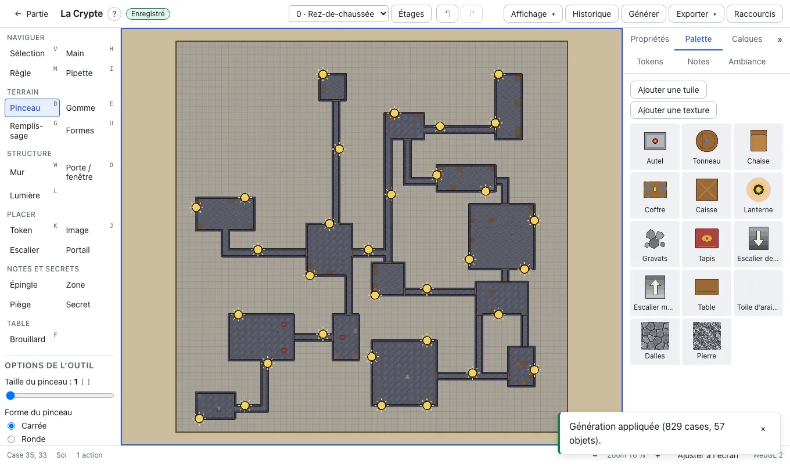
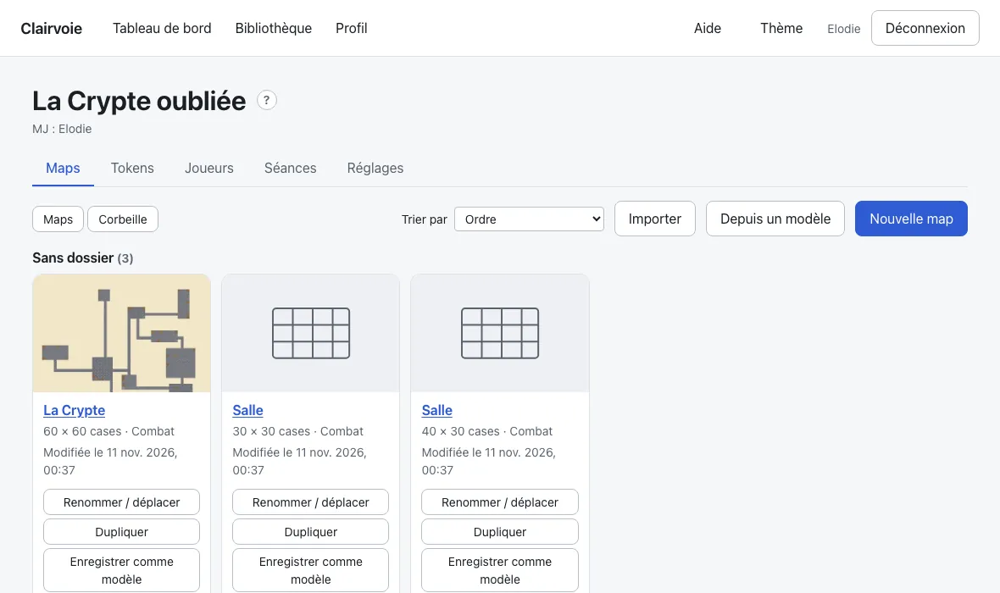
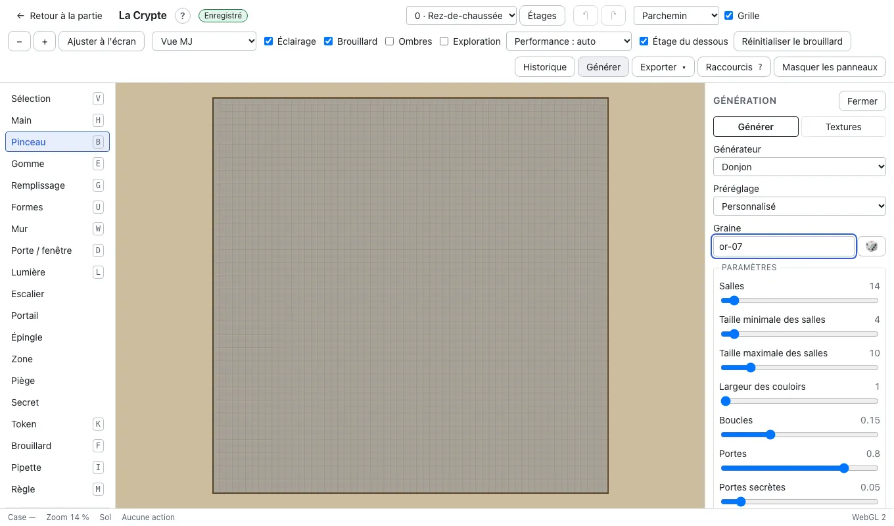
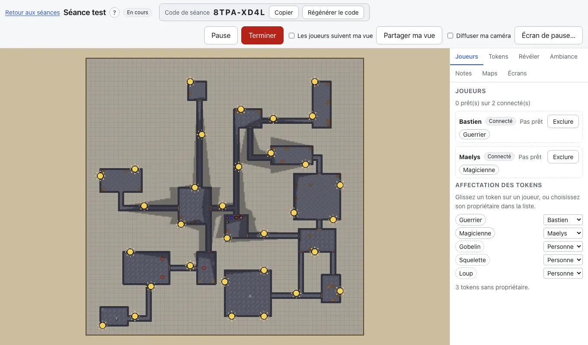
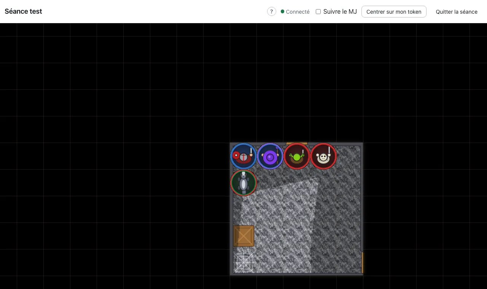
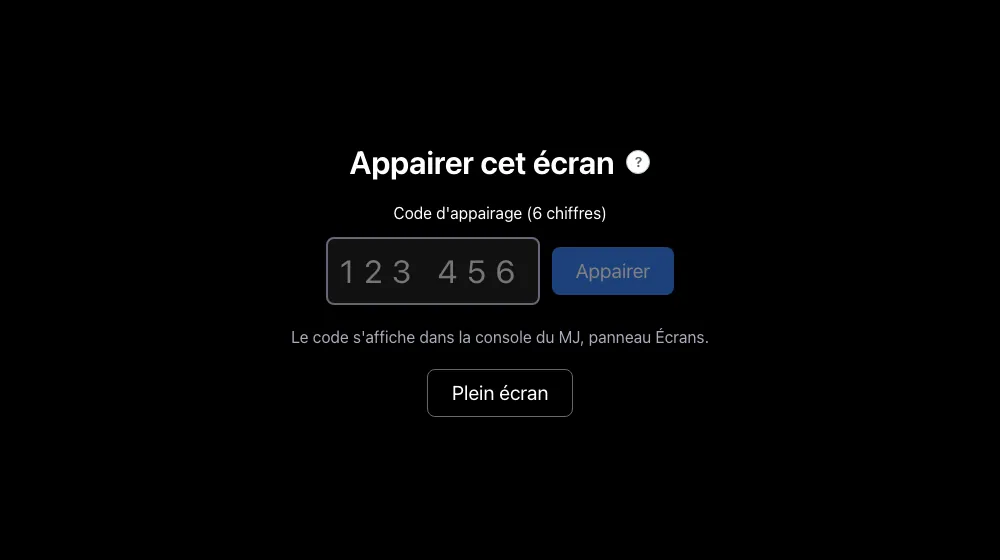
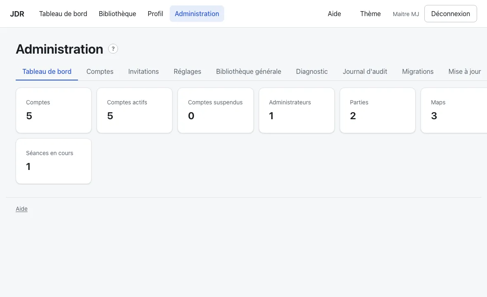

# Clairvoie

**Construisez, révélez et projetez vos cartes de jeu de rôle, en ligne ou autour de la table.**

> [!NOTE]
> Clairvoie est en **alpha** : utilisable pour des essais entre amis, des changements incompatibles restent possibles avant la version stable.

*Une clairvoie est une ouverture dans un mur qui laisse passer le regard : murs, lumière et vision sont au cœur de l'outil. Le dépôt et les archives gardent leur nom technique `JDR` / `jdr-…`.*

## Ce qu'on peut faire

Clairvoie est fait pour le maître de jeu qui prépare ses cartes, puis les montre à ses joueurs sans rien leur révéler d'avance. Voici le parcours complet, de la préparation à l'administration. Le détail de chaque fonction : [docs/fonctionnalites.md](docs/fonctionnalites.md).

### Préparer : parties, joueurs, bibliothèque, tokens

Tout part d'une partie : vous y rangez vos maps, vos joueurs, vos images et vos personnages.

- Des **parties** que l'on crée, archive ou remet depuis la corbeille, avec des membres et des co-MJ.
- Des données **strictement cloisonnées** entre les parties.
- Une **bibliothèque d'images** par glisser-déposer, avec catégories, tags, favoris et quotas ; les fichiers sont contrôlés et ré-encodés, avec miniatures.
- Des **tokens** (image, taille, vision, lumière) et des **rencontres préparées** à l'avance.
- Des **modèles de map**, dont 4 livrés : taverne, crypte, forêt, grotte.

<table><tr><td width="50%"></td><td width="50%"></td></tr></table>

### Créer ses maps

L'éditeur dessine vos cartes à la grille, avec murs, portes et lumière, et enregistre tout seul.

- **Terrain** : calques, tuiles, pinceau, gomme, remplissage, formes, sélection, pipette, règle, annuler et rétablir.
- **Murs, portes et fenêtres** : murs en polyligne ou par pièce, portes ouvrables, verrouillées ou secrètes.
- **Lumières et ambiance** : torche, lanterne, bougie, feu de camp, lumière magique ; obscurité, teinte, cycle jour et nuit, ombres portées.
- **Étages** : jusqu'à 10 par map, avec escaliers et portails vers un autre étage ou une autre map.
- **Notes et secrets** : notes, épingles, zones à lire, pièges et secrets.
- **Génération procédurale** : donjons, grottes, extérieurs et villages, à partir d'une graine reproductible (la même graine redonne la même map).
- **Versions** : historique restaurable, export et import JSON ou ZIP.
- **Hors ligne** : une coupure réseau ne fait pas perdre le travail, les modifications sont resynchronisées.
- **Export PNG** haute résolution, fond transparent, et **impression** (A4, A3, Letter).

<table><tr><td width="50%"></td><td width="50%"></td></tr></table>

### Jouer : la séance en temps réel

Le MJ lance une séance, les joueurs la rejoignent depuis leur navigateur, sans compte à créer pour les écrans de table.

- Un **code de séance** à saisir sur `/join`, puis un **lobby** avec préchargement.
- Une **console MJ** : joueurs, affectations, tokens, révélations, ambiance, notes, maps.
- **Brouillard et vision** : la lumière et la vue s'arrêtent aux murs, les joueurs explorent un brouillard de guerre et ne reçoivent que ce qu'ils ont vu.
- **Révélations** : l'outil Révéler/masquer et la vue « comme le joueur ».
- **Pause**, **notes lues à voix haute**, expulsion d'un joueur.
- Le MJ **fait voyager la table** d'un clic par un escalier ou un portail ; joueurs et écrans suivent.
- Les **joueurs jouent sur mobile**, sans rien installer.
- Temps réel sans WebSocket : bascule automatique selon l'hébergement.

<table><tr><td width="50%"></td><td width="50%"></td></tr></table>

### Autour de la table : écrans en présentiel

Une tablette, une télévision ou un vidéoprojecteur à plat sur la table affiche la map à taille réelle, pour y poser de vraies figurines.

- Des **écrans appairés** à la séance avec un code à 6 chiffres ou un QR code, sans compte (jusqu'à 8, révocation immédiate).
- **Échelle réelle** (25 mm par case par défaut), calibrée à la diagonale ou à la règle.
- **Rotation** et **miroir** de l'image, pilotage de la caméra, verrou de vue.
- L'écran ne montre que la vue de table.

<table><tr><td width="50%"></td><td width="50%"></td></tr></table>

### Administrer son site

Le site tient sur un hébergement mutualisé ordinaire, et l'administrateur dispose de sa console.

- **Comptes** : inscription ouverte, fermée ou sur invitation, quotas, réinitialisation de mot de passe, export et suppression des données personnelles.
- **Réglages** du site, e-mail de test, journal d'audit.
- **Mise à jour en un clic**, signée, qui applique aussi les migrations de la base.
- **Sauvegarde et restauration**, **intégrité** (avec réparation) et **diagnostic**.
- **Mode maintenance** pendant les mises à jour.

<table><tr><td width="50%"></td><td width="50%"></td></tr></table>

### Accessibilité, thèmes et aide intégrée

- Interface en français, thème clair, sombre ou automatique, trois styles : moderne, fantasy, science-fiction. Voir [Accessibilité](docs/accessibilite.md).
- Une **aide intégrée** (`/aide`) pour le joueur, le MJ, l'écran de table et l'administrateur, avec recherche, raccourcis clavier et captures.

### Ce que Clairvoie n'est pas

Clairvoie n'est **pas un VTT de règles** : pas de dés, pas d'initiative, pas de fiches de personnage, pas de points de vie. L'outil sert à la carte, pas aux règles.

## Comment ça marche

- Un **hébergement mutualisé ordinaire** suffit : PHP 8.1 et MySQL ou MariaDB, sans démon, sans Composer, sans WebSocket.
- Le MJ et les joueurs utilisent un **navigateur** : rien à installer côté joueurs, ni compte pour les écrans de table.
- L'administrateur du site envoie les fichiers, ouvre `install.php`, et c'est prêt.

## Installer en 5 minutes

1. Téléchargez l'archive `jdr-v…-full.zip` de la [dernière release](https://github.com/collet-david-pro/JDR/releases/latest) et décompressez-la.
2. Envoyez **tout le contenu** du dossier sur votre hébergement (souvent `www/` ou `public_html/`), fichiers cachés compris.
3. Créez une base MySQL ou MariaDB dans le panneau de l'hébergeur.
4. Ouvrez `https://votre-site/install.php` et suivez les 6 étapes.
5. Connectez-vous, créez une partie, puis une map.

Première fois ? Suivez le [tutoriel pas à pas](docs/TUTORIEL.md), de l'installation à la première séance. Prérequis détaillés : [docs/prerequis.md](docs/prerequis.md).

## Documentation

| Pour | Page |
|---|---|
| Démarrer | [Tutoriel](docs/TUTORIEL.md) · [Prérequis](docs/prerequis.md) · [Installation](docs/installation.md) |
| Exploiter | [Mise à jour](docs/mise-a-jour.md) · [Sauvegarde](docs/sauvegarde.md) · [Diagnostic](docs/diagnostic.md) |
| Serveurs particuliers | [Nginx](docs/nginx.md) · [YunoHost](docs/yunohost.md) |
| Sécurité et accessibilité | [Sécurité](docs/securite.md) · [Accessibilité](docs/accessibilite.md) |
| Comprendre | [Fonctionnalités](docs/fonctionnalites.md) · [Mode présentiel](docs/irl.md) · [Génération](docs/procgen.md) · [Temps réel](docs/realtime.md) |
| Suivre | [CHANGELOG](CHANGELOG.md) · aide intégrée du site : `/aide` |

## Contribuer et développer

- **Donner son avis / signaler un problème** : [ouvrir une issue](https://github.com/collet-david-pro/JDR/issues/new/choose) (version, hébergement, navigateur, étapes pour reproduire).
- Le projet est développé par son auteur seul et **n'accepte pas de pull requests**. Vous pouvez en revanche **forker** le dépôt, dans le respect de la [licence](#licence).
- Pour le code : [AGENTS.md](AGENTS.md), [docs/dev/](docs/dev/) (architecture, décisions, recettes) et [dev/README.md](dev/README.md) (environnement local, tests, livraison).

## Licence

[PolyForm Noncommercial 1.0.0](LICENSE.md) : gratuit pour tout usage non commercial (jeu, groupe, association, enseignement), aucun usage commercial. Le texte de la licence et la mention suivante doivent être conservés :

> Required Notice: Copyright 2026 David COLLET (https://github.com/collet-david-pro/JDR)

Auteur : David COLLET. Clairvoie a été conçu avec l'IA, avec Claude Code : voir [docs/conception-ia.md](docs/conception-ia.md).
