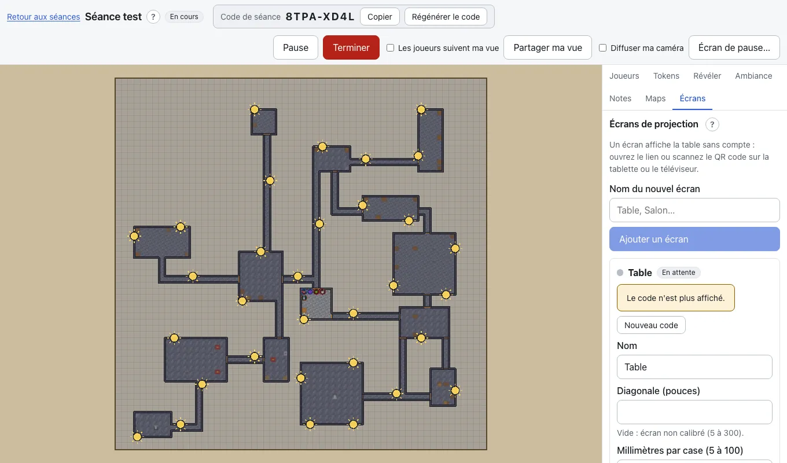
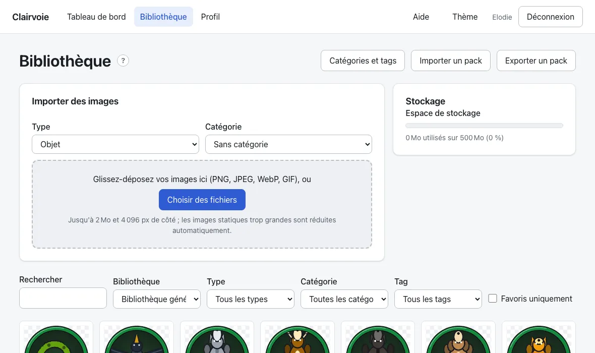
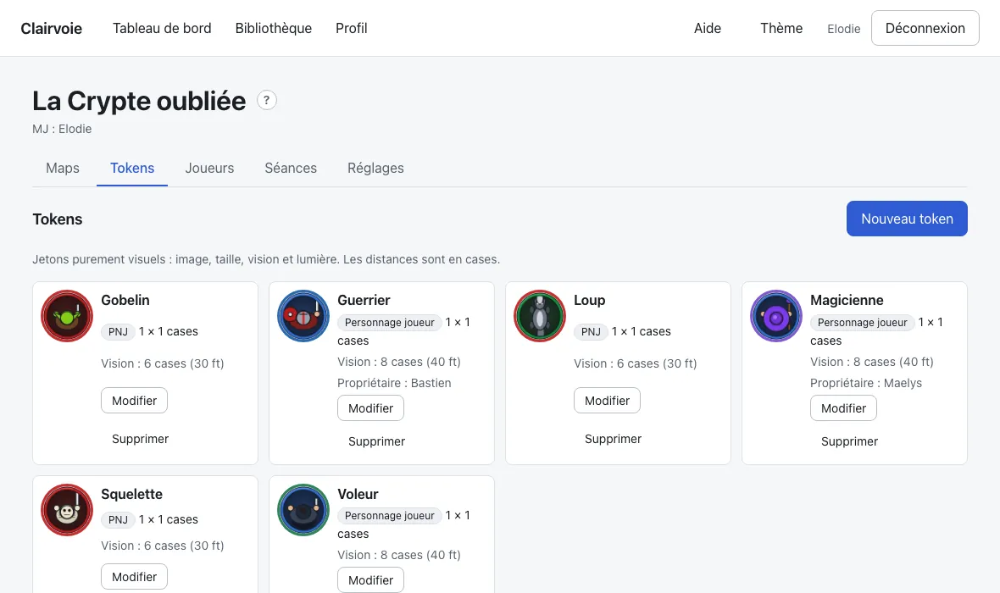
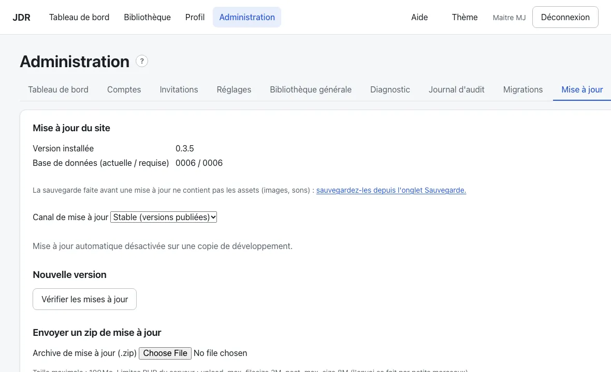

# Clairvoie

**Construisez, révélez et projetez vos cartes de jeu de rôle, en ligne ou autour de la table.**

> [!NOTE]
> Clairvoie est en **alpha** : utilisable pour des essais entre amis, des changements incompatibles restent possibles avant la version stable.

*Une clairvoie est une ouverture dans un mur qui laisse passer le regard : murs, lumière et vision sont au cœur de l'outil. Le dépôt et les archives gardent leur nom technique `JDR` / `jdr-…`.*

## Ce qu'on peut faire

Clairvoie est fait pour le maître de jeu qui prépare ses cartes, puis les montre à ses joueurs sans rien leur révéler d'avance. Ce n'est **pas** un outil de règles : ni dés, ni fiches de personnage.

| | |
|---|---|
|  | **Dessiner ses maps.** Grille, calques, tuiles, étages, escaliers, notes, modèles. Enregistrement automatique, même hors ligne. |
|  | **Générer des maps.** Donjons, grottes, extérieurs et villages, à partir d'une graine reproductible. |
|  | **Murs, lumière et brouillard.** Portes, torches, vision des tokens, brouillard de guerre que les joueurs explorent. |
|  | **Jouer en ligne.** Les joueurs rejoignent la séance avec un simple code, dans leur navigateur. Ils ne voient que ce qu'ils ont exploré. |
|  | **Jouer autour de la table.** Une tablette ou un vidéoprojecteur affiche la map à l'échelle réelle, pour y poser de vraies figurines. |
|  | **Ranger ses images.** Bibliothèque avec catégories, tags, quotas et contrôle strict des fichiers. |
|  | **Organiser ses parties.** Maps par partie, tokens, rencontres préparées, co-MJ. |
|  | **Rester chez soi.** Vos comptes, maps et images restent sur votre hébergement, qui se met à jour tout seul. |

Le détail de chaque fonction : [docs/fonctionnalites.md](docs/fonctionnalites.md).

## Comment ça marche

- Un **hébergement mutualisé ordinaire** suffit : PHP 8.1 et MySQL ou MariaDB, sans démon, sans Composer, sans WebSocket.
- Le MJ et les joueurs utilisent un **navigateur** : rien à installer côté joueurs, ni compte pour les écrans de table.
- L'administrateur du site envoie les fichiers, ouvre `install.php`, et c'est prêt.

## Installer en 5 minutes

1. Téléchargez l'archive `jdr-v…-full.zip` de la [dernière release](https://github.com/collet-david-pro/JDR/releases/latest) et décompressez-la.
2. Envoyez **tout le contenu** du dossier sur votre hébergement (souvent `www/` ou `public_html/`), fichiers cachés compris.
3. Créez une base MySQL ou MariaDB dans le panneau de l'hébergeur.
4. Ouvrez `https://votre-site/install.php` et suivez les 6 étapes.
5. Connectez-vous, créez une partie, puis une map.

Première fois ? Suivez le [tutoriel pas à pas](docs/TUTORIEL.md), de l'installation à la première séance. Prérequis détaillés : [docs/prerequis.md](docs/prerequis.md).

## Documentation

| Pour | Page |
|---|---|
| Démarrer | [Tutoriel](docs/TUTORIEL.md) · [Prérequis](docs/prerequis.md) · [Installation](docs/installation.md) |
| Exploiter | [Mise à jour](docs/mise-a-jour.md) · [Sauvegarde](docs/sauvegarde.md) · [Diagnostic](docs/diagnostic.md) |
| Serveurs particuliers | [Nginx](docs/nginx.md) · [YunoHost](docs/yunohost.md) |
| Sécurité et accessibilité | [Sécurité](docs/securite.md) · [Accessibilité](docs/accessibilite.md) |
| Comprendre | [Fonctionnalités](docs/fonctionnalites.md) · [Mode présentiel](docs/irl.md) · [Génération](docs/procgen.md) · [Temps réel](docs/realtime.md) |
| Suivre | [CHANGELOG](CHANGELOG.md) · aide intégrée du site : `/aide` |

## Contribuer et développer

- **Signaler un défaut ou proposer une idée** : ouvrez une [issue](https://github.com/collet-david-pro/JDR/issues) (version, hébergement, navigateur, étapes pour reproduire).
- Le projet est développé par son auteur seul et **n'accepte pas de pull requests**. Vous pouvez en revanche **forker** le dépôt, dans le respect de la [licence](#licence).
- Pour le code : [AGENTS.md](AGENTS.md), [docs/dev/](docs/dev/) (architecture, décisions, recettes) et [dev/README.md](dev/README.md) (environnement local, tests, livraison).

## Licence

[PolyForm Noncommercial 1.0.0](LICENSE.md) : gratuit pour tout usage non commercial (jeu, groupe, association, enseignement), aucun usage commercial. Le texte de la licence et la mention suivante doivent être conservés :

> Required Notice: Copyright 2026 David COLLET (https://github.com/collet-david-pro/JDR)

Auteur : David COLLET. Clairvoie a été conçu avec l'IA, avec Claude Code : voir [docs/conception-ia.md](docs/conception-ia.md).
