

# Clairvoie

**Préparez vos cartes, plongez vos joueurs dans le noir, et ne révélez que ce que leurs personnages voient.** 
Une table virtuelle centrée sur la carte, pour jouer en ligne ou autour d'une vraie table, installée sur votre propre hébergement.

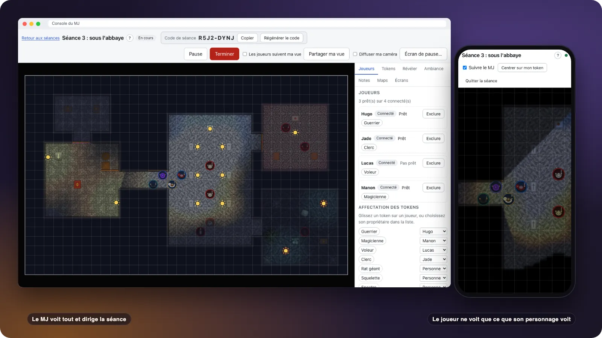

[**Installer**](#installer-en-5-minutes) · [Une séance racontée](#une-séance-racontée) · [Fonctionnalités](#ce-que-fait-clairvoie) · [Documentation](#documentation) · [FAQ](#questions-fréquentes)

> [!NOTE]
> Clairvoie est **en développement** (versions 0.x) : il sert déjà à de vraies parties entre amis, mais des changements incompatibles restent possibles avant la version stable.

Clairvoie est fait pour le **maître de jeu** (MJ) qui veut montrer une carte sans rien gâcher : il dessine ou génère ses maps avec leurs murs, leurs portes et leurs lumières, puis il lance la séance. Chaque **joueur** la rejoint depuis son navigateur, ordinateur ou téléphone, et ne reçoit que ce que son personnage a vu. Autour d'une vraie table, une tablette ou une télévision posée à plat affiche la carte à l'échelle des figurines.

Le tout tient sur un **hébergement web ordinaire** (PHP et MySQL) : on envoie les fichiers, on ouvre une page d'installation, et c'est prêt. Pas de serveur à administrer, pas d'abonnement, pas de compte chez un tiers.

Une *clairvoie* est une ouverture dans un mur qui laisse passer le regard : murs, lumière et vision sont au cœur de l'outil. L'interface, le dépôt et les archives portent encore le nom technique **JDR** (`jdr-…`).

## Sommaire

- [Pourquoi Clairvoie](#pourquoi-clairvoie)
- [Une séance racontée](#une-séance-racontée)
- [Ce que fait Clairvoie](#ce-que-fait-clairvoie)
  - [Préparer la campagne](#préparer-la-campagne)
  - [Créer les maps](#créer-les-maps)
  - [Jouer en ligne](#jouer-en-ligne)
  - [Jouer autour de la table](#jouer-autour-de-la-table)
  - [Administrer son site](#administrer-son-site)
  - [Accessibilité, thèmes et aide](#accessibilité-thèmes-et-aide)
- [Ce que Clairvoie n'est pas](#ce-que-clairvoie-nest-pas)
- [Installer en 5 minutes](#installer-en-5-minutes)
- [Documentation](#documentation)
- [Questions fréquentes](#questions-fréquentes)
- [Contribuer et donner son avis](#contribuer-et-donner-son-avis)
- [Licence](#licence)

## Pourquoi Clairvoie

<table>
<tr>
<td width="50%" valign="top">

**Un hébergement ordinaire suffit** 
PHP 8.1 et MySQL ou MariaDB, sans terminal, sans Composer, sans WebSocket, sans tâche planifiée obligatoire. L'installation se fait dans le navigateur, en 6 étapes.

</td>
<td width="50%" valign="top">

**Rien à installer pour les joueurs** 
Un navigateur récent suffit, sur ordinateur ou téléphone. Les écrans posés sur la table n'ont même pas besoin de compte : un code à 6 chiffres ou un QR code les relie à la séance.

</td>
</tr>
<tr>
<td valign="top">

**Un brouillard qui ne triche pas** 
C'est le serveur qui trie ce que chacun reçoit : un joueur qui fouille son navigateur n'y trouve ni la carte cachée, ni les monstres masqués, ni les portes secrètes.

</td>
<td valign="top">

**Rien ne se perd** 
L'éditeur enregistre tout seul et continue sans réseau ; les modifications repartent dès que la connexion revient. Chaque map garde un historique de versions restaurables.

</td>
</tr>
<tr>
<td valign="top">

**Des mises à jour signées, en un clic** 
Le site se met à jour seul ou d'un clic, après avoir vérifié la signature de la version publiée. Une sauvegarde de la base est faite avant, et un échec est annulé.

</td>
<td valign="top">

**Vos données restent chez vous** 
Comptes, cartes et images sont sur votre hébergement. Les pages ne chargent rien d'ailleurs : ni police externe, ni outil de mesure d'audience. Chacun peut exporter ou supprimer ses données.

</td>
</tr>
<tr>
<td valign="top">

**Pensé pour tous** 
Objectif WCAG 2.2 AA hors carte, tout au clavier, thème clair ou sombre, trois styles d'interface, et une aide intégrée pour chaque public.

</td>
<td valign="top">

**Testé en profondeur** 
Des milliers de tests automatisés, dont des parcours complets dans Chromium, Firefox et WebKit, et une revue de sécurité OWASP Top 10.

</td>
</tr>
</table>

## Une séance racontée

Camille est MJ. Ce soir, ses quatre joueurs descendent dans **la Crypte de Valombre** : deux jouent à distance, deux sont dans son salon.

**1. Préparer.** Camille a dessiné la crypte dans l'éditeur : un vestibule, un couloir, la salle des gisants et sa lumière bleue, une chapelle verrouillée, une porte secrète vers une salle au trésor. L'éditeur règle l'obscurité, place torches et bougies, et montre à tout moment la carte « comme les joueurs la verront ».

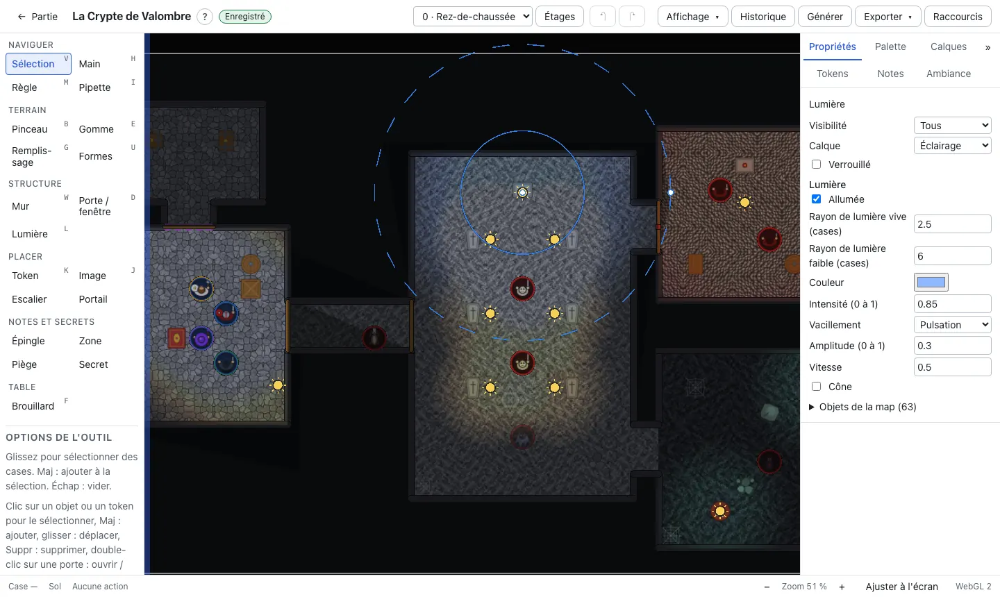

**2. Lancer.** Elle ouvre une séance : Clairvoie affiche un code à donner aux joueurs. Chacun le saisit, arrive dans la salle d'attente pendant que la carte se précharge, et se déclare prêt. Camille affecte un personnage à chacun, puis clique sur **Lancer**.

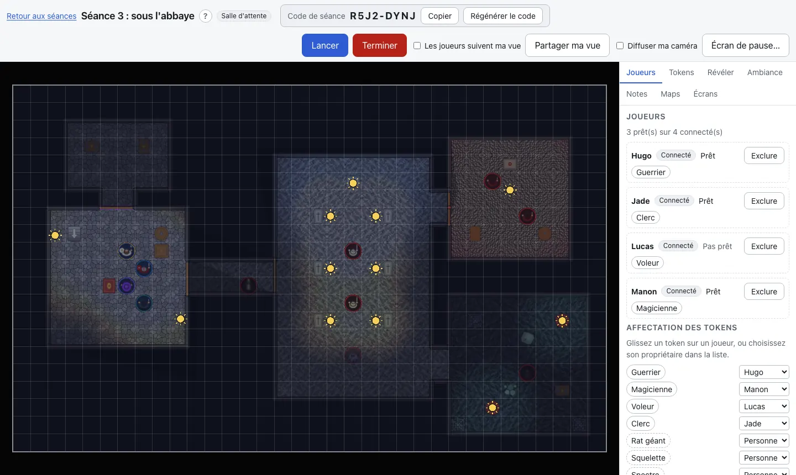

**3. Explorer.** Le groupe n'aperçoit que le vestibule éclairé. Camille ouvre la porte : la lanterne du clerc éclaire le couloir, un rat géant détale, et la seconde porte révèle la salle des gisants. Ce qui a été vu reste grisé ; le reste demeure noir, même dans le code de la page.

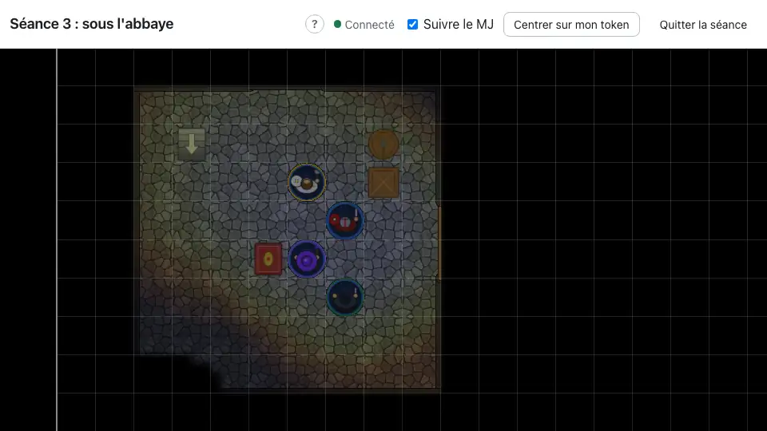

**4. Raconter.** Les joueurs à distance suivent sur leur téléphone. Quand ils entrent, Camille envoie le texte à lire : il s'ouvre en grand chez tout le monde.

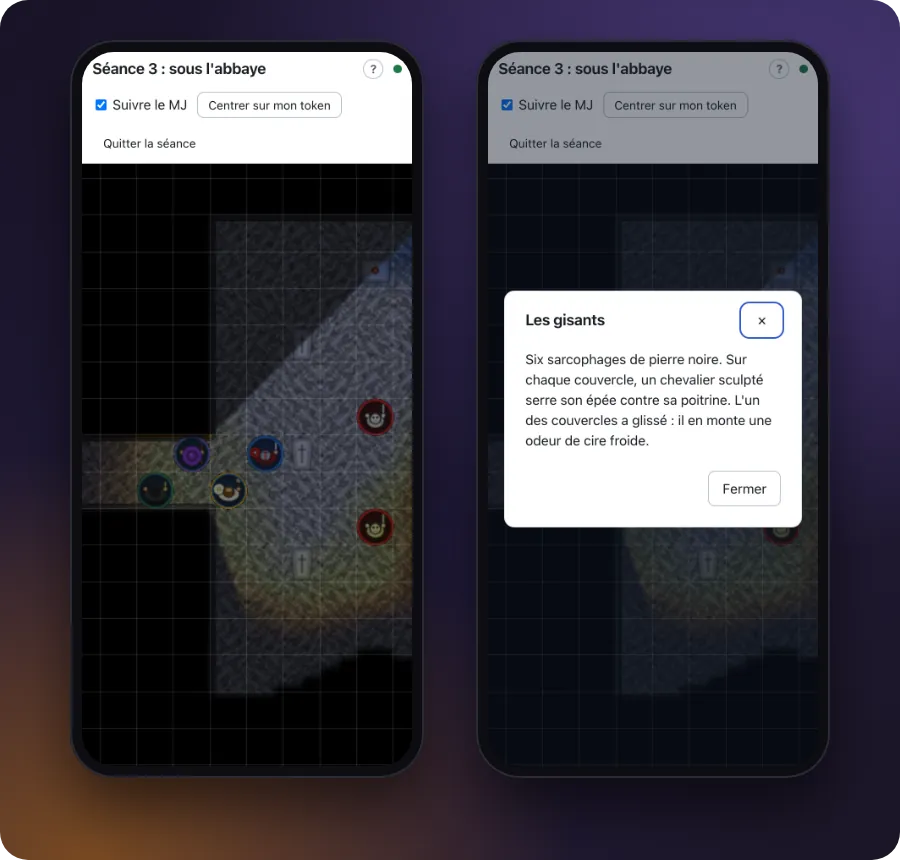

**5. Autour de la table.** Dans le salon, une tablette posée à plat affiche la **vue de table** à l'échelle des figurines : ce que tout le groupe a découvert, jamais ce que Camille garde pour elle.

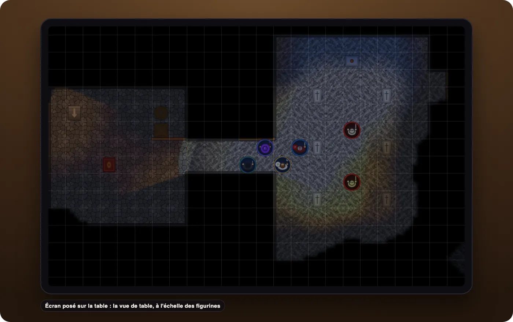

À la fin, Camille termine la séance : les joueurs sont déconnectés, les écrans aussi, et le brouillard exploré est gardé pour la suite.

## Ce que fait Clairvoie

Chaque fonction est détaillée dans [docs/fonctionnalites.md](docs/fonctionnalites.md) et dans l'aide intégrée du site (`/aide`).

### Préparer la campagne

Une **partie** regroupe tout ce qu'il faut à une campagne : ses maps, ses personnages, ses joueurs et ses séances.

- **Parties** que l'on archive ou récupère dans la corbeille, avec des **co-MJ** qui préparent et dirigent comme vous.
- **Joueurs** ajoutés par pseudo ou e-mail, ou qui arrivent seuls avec le code d'une séance.
- **Tokens** (personnages, monstres, objets) avec image, taille, anneau de couleur, vision, vision dans le noir et lumière portée. Une quarantaine sont fournis : héros, monstres, PNJ et animaux.
- **Tokens des joueurs** : chaque joueur crée les siens sans logiciel de dessin (forme, couleurs, anneau, emblème ou portrait cadré) et choisit lequel il utilise dans chaque partie ; le MJ peut toujours imposer son image.
- **Rencontres** préparées à l'avance (une embuscade, une bande de gobelins) qui se posent d'un coup sur la carte.
- **Bibliothèque d'images** par glisser-déposer, avec catégories, tags, favoris, quotas et packs à échanger entre sites ; une bibliothèque générale partagée par tous les MJ, avec un pack de sols, de décors et de tokens.
- **Cloisonnement strict** : rien ne passe d'une partie à l'autre.

<table>
<tr>
<td width="50%">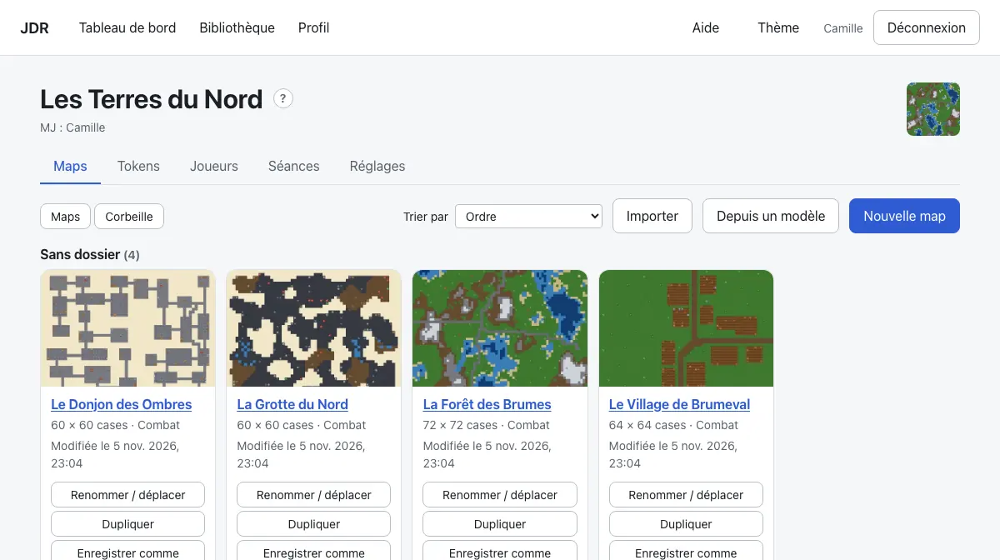</td>
<td width="50%">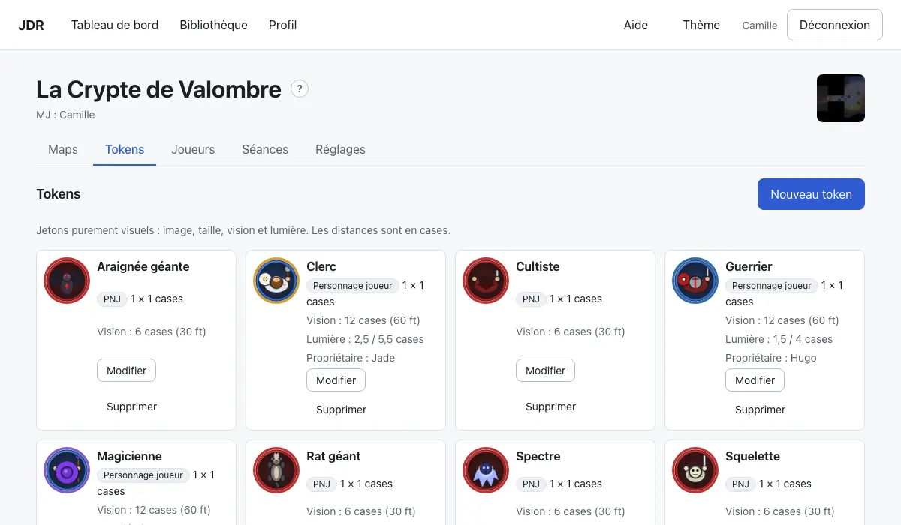</td>
</tr>
</table>

### Créer les maps

L'éditeur dessine à la grille, enregistre tout seul et sait tout annuler. Une battlemap toute faite s'importe en fond de map : il ne reste qu'à poser les murs, les portes et les lumières.

<b>Tout ce que fait l'éditeur</b>

- **Terrain** : calques Sol, Terrain et Décor, tuiles et textures continues, pinceau, gomme, remplissage, formes, sélection, pipette, règle, annuler et rétablir.
- **Images et fonds de map** : nouvelle map depuis une image (la taille se calcule à partir de la taille d'une case, ou l'image s'ajuste à la taille de map voulue en gardant ses proportions), fond recalé sur la grille à chaque étage (les battlemaps de plus de 4096 px sont découpées en morceaux à l'envoi), outil Image pour poser librement les objets de la bibliothèque, animés compris (déplacer, redimensionner, tourner, miroir, opacité, sous ou sur les tuiles, ou sur le calque MJ). La taille de la map se change à tout moment, avec un point d'ancrage, et le contenu suit.
- **Murs, portes et fenêtres** : murs tracés point par point ou par pièce, avec aimantation réglable jusqu'au huitième de case ; portes ouvertes, fermées, verrouillées ou secrètes ; fenêtres vitrées, à barreaux ou simples ouvertures ; textures de murs et images de porte prises dans la bibliothèque. Les murs arrêtent la vue, la lumière et les déplacements.
- **Lumières** : torche, lanterne, bougie, feu de camp, lumière magique ; couleur, intensité, vacillement, cône.
- **Ambiance** : obscurité, teinte, cycle jour et nuit, ombres portées, météo animée (pluie, orage, neige, brume), et un aperçu « comme tous les joueurs » ou « comme ce personnage ».
- **Étages** : jusqu'à 10 par map, l'étage du dessous visible en transparence ; escaliers, portails et portes qui mènent à un autre étage ou à une autre map.
- **Notes et secrets** : notes en Markdown (réservées au MJ ou partagées), épingles, zones qui suggèrent un texte quand un personnage y entre, pièges et passages secrets.
- **Modèles** : enregistrer une map comme modèle, ou partir d'un des 4 modèles fournis (taverne, crypte, forêt, grotte).
- **Versions** : un instantané toutes les 5 minutes d'édition, d'autres à la demande, restaurables à tout moment.
- **Échanges** : export et import en JSON ou en ZIP avec les images, pour passer une map à un autre MJ ou à un autre site.
- **Image et impression** : export PNG haute résolution, fond transparent possible, et impression à l'échelle (1 case = N mm) découpée en pages A4, A3 ou Letter, avec repères de coupe.
- **Palette de commandes** (Ctrl+K ou Cmd+K) et raccourcis clavier pour chaque outil.

**Génération procédurale.** Quatre générateurs créent une carte complète, murs, portes et décor compris, en quelques secondes : **donjon**, **grotte**, **extérieur** (rivières, routes, ponts et gués) et **village** (bâtiments, pièces, mobilier). Une **graine** rend le résultat reproductible : la même graine redonne la même carte. On peut générer une nouvelle map, remplacer la map en cours ou seulement une zone sélectionnée, et un seul « annuler » défait tout.

<table>
<tr>
<td width="50%" align="center">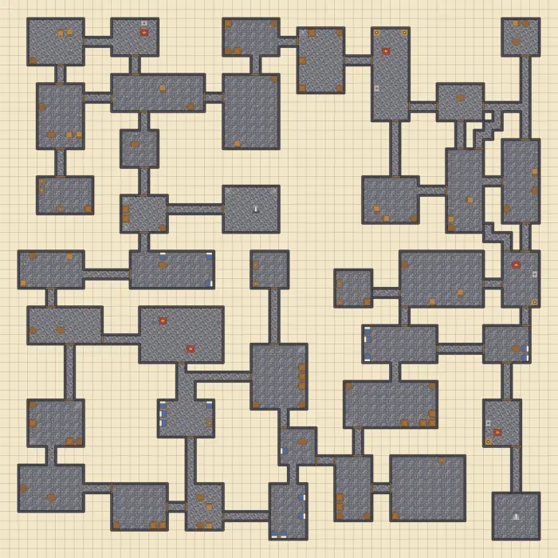 Donjon</td>
<td width="50%" align="center">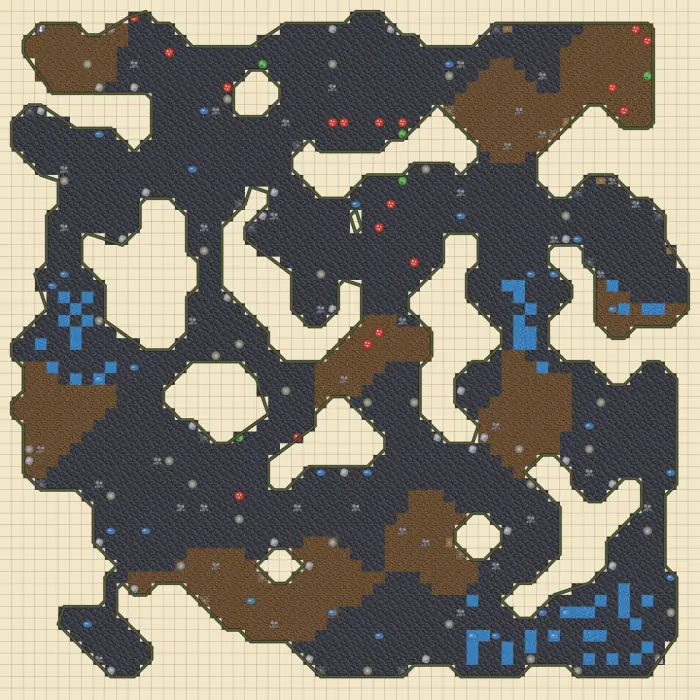 Grotte</td>
</tr>
<tr>
<td align="center">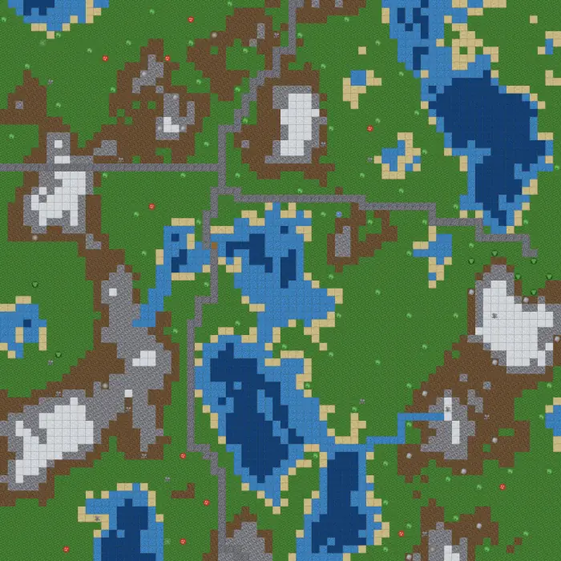 Extérieur</td>
<td align="center">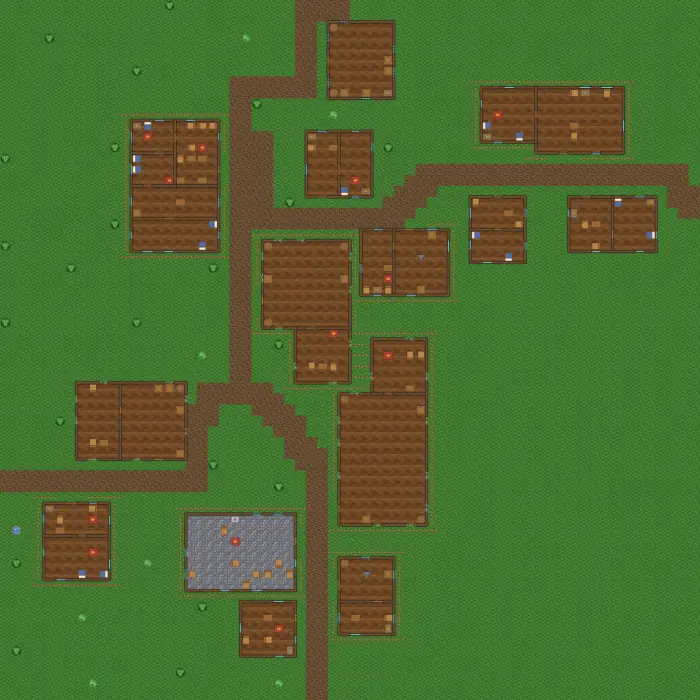 Village</td>
</tr>
</table>

Ces quatre cartes sont les exports PNG des cartes générées, sans retouche.

### Jouer en ligne

Le MJ dirige depuis sa **console** ; les joueurs jouent dans leur navigateur, sur ordinateur ou sur téléphone.

- **Code de séance** à transmettre, **salle d'attente** avec préchargement de la carte, affectation des personnages.
- **Vision et brouillard** : la lumière et la vue s'arrêtent aux murs ; chaque joueur ne voit que ce que ses personnages voient, plus ce qui a déjà été exploré. Par défaut, les tokens des joueurs ne traversent ni murs ni portes fermées.
- **Révélations** : ouvrir une porte d'un clic, éclairer une salle, dévoiler un token, un piège ou un passage secret, révéler ou masquer le brouillard au pinceau ou au rectangle.
- **Raconter** : textes lus à voix haute affichés en grand, notes partagées à un, plusieurs ou tous les joueurs, écran de pause avec image et texte.
- **Faire voyager la table** : changer de map, ou emprunter un escalier ou un portail ; joueurs et écrans suivent, avec les personnages choisis, sans jamais voir la destination à l'avance.
- **Caméra** : les joueurs peuvent suivre la vue du MJ, qui la partage ou la diffuse en continu.
- **Temps réel sans WebSocket** : flux SSE, puis attente longue, puis interrogation régulière, avec bascule automatique selon ce que permet l'hébergement, et rattrapage après une coupure.

<table>
<tr>
<td width="50%">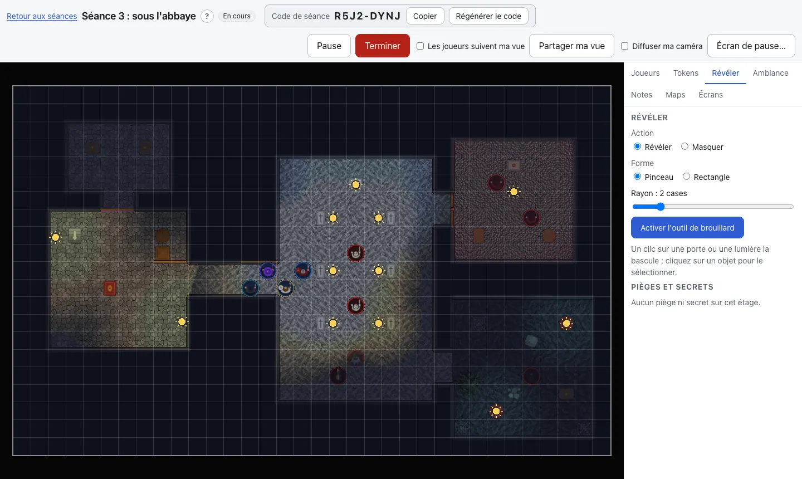</td>
<td width="50%">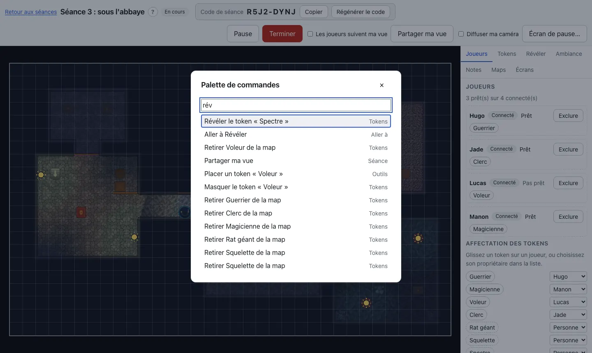</td>
</tr>
</table>

### Jouer autour de la table

Une tablette, une télévision posée à plat ou un vidéoprojecteur affiche la carte à **taille réelle** pour y poser de vraies figurines.

- Écrans reliés à la séance par un **code à 6 chiffres** ou un **QR code**, **sans compte** ; jusqu'à 8 par séance, révocables à tout moment.
- **Échelle réelle** : 25 mm par case par défaut, calibrée à partir de la diagonale de l'écran ou d'une règle posée contre lui.
- **Rotation** et **miroir** (écran vu de côté, projection au plafond), suivi de la caméra du MJ ou **vue verrouillée**, tokens affichés ou non.
- L'écran reste allumé et ne montre que la vue de table : jamais un token caché, une note ou une porte secrète. Après une mise à jour du site, il se recharge seul.

<table>
<tr>
<td width="60%">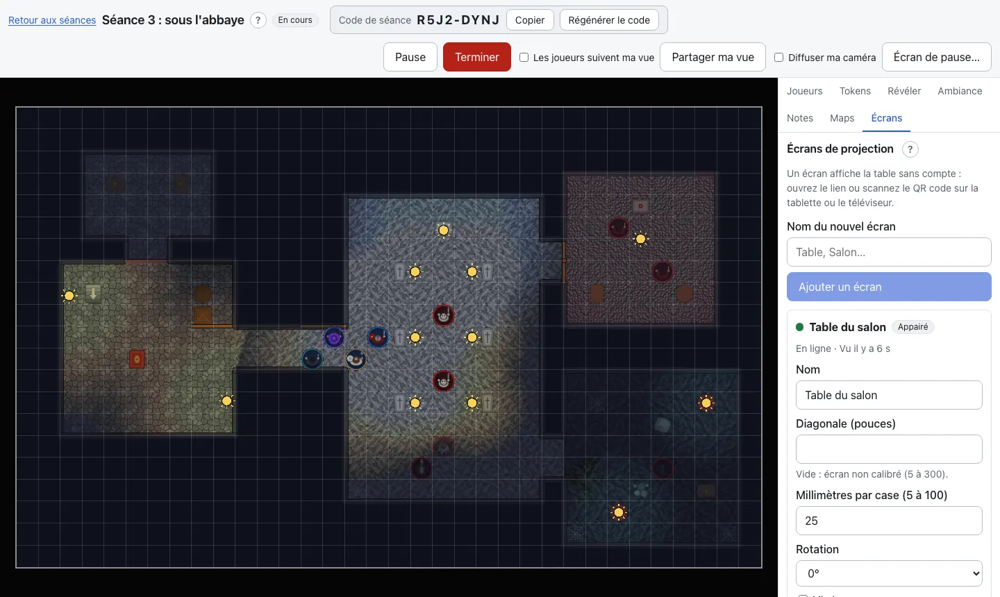</td>
<td width="40%"></td>
</tr>
</table>

### Administrer son site

L'administrateur a sa console, pensée pour quelqu'un qui n'est pas informaticien.

- **Comptes** : inscription ouverte, fermée ou sur invitation, quotas d'espace, suspension, lien de réinitialisation du mot de passe (l'envoi d'e-mails est facultatif).
- **Réglages** du site, **mode maintenance**, e-mail de test, **journal d'audit**.
- **Mise à jour** automatique ou en un clic, vérifiée par signature, avec sauvegarde et retour arrière.
- **Sauvegarde et restauration** de la base et des images, sans copie laissée sur le serveur.
- **Diagnostic** du serveur (dont un test du temps réel) et **vérification d'intégrité** avec corrections guidées.

<table>
<tr>
<td width="50%">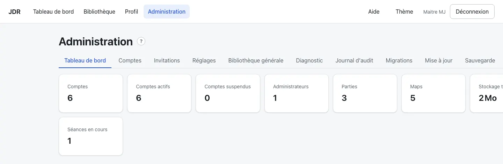</td>
<td width="50%">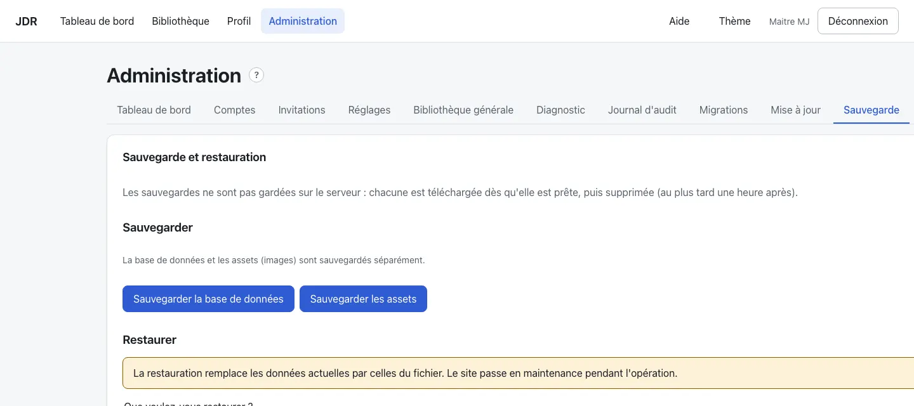</td>
</tr>
</table>

### Accessibilité, thèmes et aide

- **Thème** clair, sombre ou automatique, et trois **styles** : moderne, fantasy, science-fiction. Le choix suit le compte d'un appareil à l'autre.
- **Accessibilité** : objectif WCAG 2.2 niveau AA hors carte, parcours entièrement au clavier, contrastes vérifiés, liste textuelle des objets de la carte. Détails et limites : [docs/accessibilite.md](docs/accessibilite.md).
- **Aide intégrée** (`/aide`, accessible sans compte) pour le joueur, le MJ, l'écran de table et l'administrateur, avec recherche, raccourcis clavier et captures ; un lien « ? » dans chaque écran mène à la bonne section.
- **Visites guidées** : à la première ouverture de chaque écran principal (tableau de bord, partie, éditeur, console du MJ, vue du joueur, administration), une courte visite le présente pas à pas ; le profil permet de les revoir.

<table>
<tr>
<td width="33%" align="center">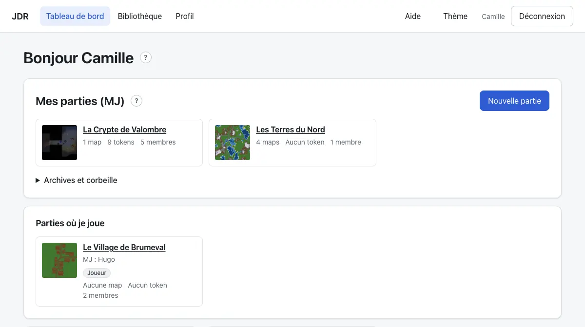 Moderne, clair</td>
<td width="33%" align="center">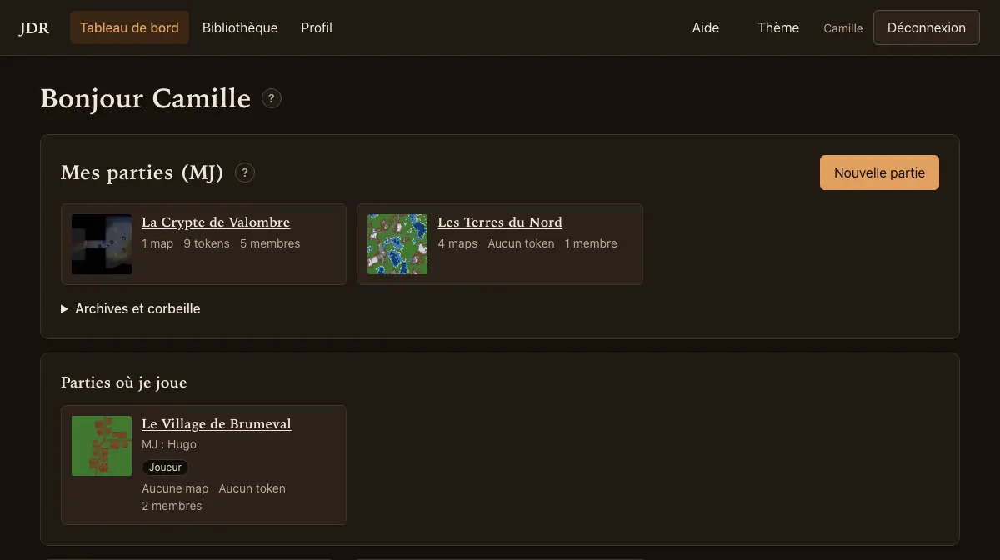 Fantasy, sombre</td>
<td width="33%" align="center">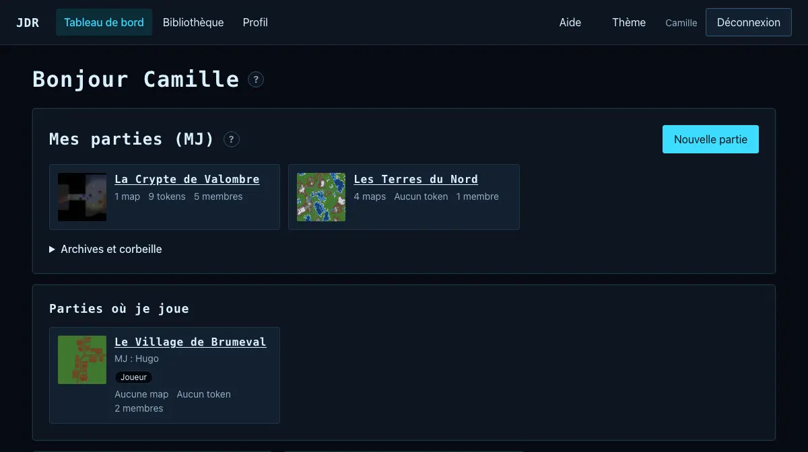 Science-fiction, sombre</td>
</tr>
</table>

## Ce que Clairvoie n'est pas

- **Pas un VTT de règles** : pas de dés, pas d'initiative, pas de fiches de personnage, pas de points de vie. Clairvoie sert la carte ; les règles restent à votre table.
- **Pas un service en ligne** : il n'y a pas de site Clairvoie où créer un compte. Chaque groupe installe le sien.
- **Pas multilingue** pour l'instant : l'interface est en français.
- **Pas une grille hexagonale** : la grille est carrée.

## Installer en 5 minutes

1. Téléchargez l'archive `jdr-v…-full.zip` de la [dernière version](https://github.com/collet-david-pro/JDR/releases/latest) et décompressez-la.
2. Envoyez **tout le contenu** du dossier sur votre hébergement (souvent `www/` ou `public_html/`), fichiers cachés compris.
3. Créez une base MySQL ou MariaDB dans le panneau de l'hébergeur.
4. Ouvrez `https://votre-site/install.php` et suivez les 6 étapes : l'assistant vérifie le serveur et dit quoi corriger.
5. Connectez-vous, créez une partie, puis une map.

> [!TIP]
> Première fois ? Le [tutoriel pas à pas](docs/TUTORIEL.md) va de l'installation à la première séance. Avant de commencer, vérifiez les [prérequis](docs/prerequis.md) ; sur un serveur YunoHost, suivez [ce guide](docs/yunohost.md).

## Documentation

| Pour | Pages |
|---|---|
| Démarrer | [Tutoriel](docs/TUTORIEL.md) · [Prérequis](docs/prerequis.md) · [Installation](docs/installation.md) · [YunoHost](docs/yunohost.md) |
| Faire vivre son site | [Mise à jour](docs/mise-a-jour.md) · [Sauvegarde](docs/sauvegarde.md) · [Diagnostic et dépannage](docs/diagnostic.md) |
| Comprendre l'outil | [Fonctionnalités](docs/fonctionnalites.md) · [Mode présentiel](docs/irl.md) · [Génération](docs/procgen.md) · [Temps réel](docs/realtime.md) |
| Sécurité et accessibilité | [Sécurité](docs/securite.md) · [Accessibilité](docs/accessibilite.md) |
| Suivre les versions | [CHANGELOG](CHANGELOG.md) · [Versions publiées](https://github.com/collet-david-pro/JDR/releases) |
| Dans le site | l'aide intégrée, à l'adresse `/aide` |

## Questions fréquentes

<b>Quel hébergement faut-il ?</b>

Un hébergement web mutualisé classique : PHP 8.1 ou plus et une base MySQL 5.7+ ou MariaDB 10.3+. Pas besoin d'accès SSH, de Composer, de Node.js ni de tâche planifiée. L'extension PHP `sodium` est conseillée : elle permet la mise à jour automatique. L'assistant d'installation contrôle tout cela à l'étape 1. Liste complète : [prérequis](docs/prerequis.md).

<b>Combien de joueurs par séance ?</b>

Clairvoie ne fixe pas de nombre de joueurs. La limite vient de l'hébergement : par défaut, 4 appareils gardent une connexion en direct avec le serveur, et les suivants l'interrogent toutes les 2 secondes, avec un peu plus de délai. Ce plafond se règle dans l'administration ([détails](docs/diagnostic.md#limite-de-connexions-en-direct)). Une partie a une seule séance ouverte à la fois, avec jusqu'à 8 écrans de table.

<b>Peut-on jouer sur téléphone ou tablette ?</b>

Oui pour les joueurs : la vue joueur fonctionne dans le navigateur du téléphone, avec zoom au pincement, sans application à installer. Une tablette ou une télévision peut aussi servir d'écran de table. Pour préparer les cartes et diriger la séance, un ordinateur est plus confortable : l'éditeur et la console du MJ s'utilisent au clavier, à la souris ou au trackpad.

<b>Que se passe-t-il si la connexion coupe ?</b>

Dans l'éditeur, rien n'est perdu : les modifications sont gardées dans le navigateur et envoyées au retour du réseau. En séance, chaque appareil se reconnecte seul et rattrape ce qu'il a manqué, sans doublon. Il faut en revanche un navigateur récent (Chrome, Firefox, Safari ou Edge à jour).

<b>Comment sauvegarder ?</b>

Dans **Administration > Sauvegarde** : un fichier pour la base, un autre pour les images, téléchargés sur votre ordinateur. Aucune copie ne reste sur le serveur, et il n'y a pas de sauvegarde automatique : pensez-y avant chaque mise à jour importante. La restauration se fait au même endroit, avec double confirmation. Voir [sauvegarde](docs/sauvegarde.md).

<b>Comment se font les mises à jour ?</b>

Par défaut, le site se met à jour seul en arrière-plan, jamais pendant une séance lancée depuis moins de 12 heures. Sinon, **Administration > Mise à jour** propose « Installer la version X » en un clic. Dans les deux cas, la signature de la version publiée est vérifiée, la base est sauvegardée avant, et un échec est annulé. L'envoi manuel d'une archive et la mise à jour par FTP restent possibles. Voir [mise à jour](docs/mise-a-jour.md).

<b>Combien ça coûte ?</b>

Rien : Clairvoie est gratuit pour tout usage non commercial (jeu entre amis, club, association, enseignement). Il faut seulement un hébergement web, que vous avez peut-être déjà. Il n'y a ni abonnement, ni publicité, ni fonction payante.

<b>Où vont mes données ?</b>

Sur votre hébergement, et nulle part ailleurs : comptes, cartes, images et journaux restent dans votre base et votre dossier `storage/`. Le serveur ne contacte GitHub que pour chercher les nouvelles versions. Chaque utilisateur peut exporter ses données ou supprimer son compte depuis son profil, et les journaux techniques sont effacés au bout de 14 jours. Voir [sécurité](docs/securite.md).

## Contribuer et donner son avis

- **Une idée, un problème ?** [Ouvrez une issue](https://github.com/collet-david-pro/JDR/issues/new/choose) en précisant la version, l'hébergement, le navigateur et les étapes pour reproduire. Pour une faille de sécurité, ne donnez pas de détail en public : voir [sécurité](docs/securite.md#signaler-une-vulnérabilité).
- Le projet est développé par son auteur seul et **n'accepte pas de pull requests**. Vous pouvez en revanche **forker** le dépôt, dans le respect de la [licence](#licence).
- Pour lire le code : [AGENTS.md](AGENTS.md), [docs/dev/](docs/dev/) (architecture, décisions, recettes) et [dev/README.md](dev/README.md) (environnement local, tests, livraison).

## Licence

[PolyForm Noncommercial 1.0.0](LICENSE.md) : gratuit pour tout usage non commercial (jeu, groupe, association, enseignement), aucun usage commercial. Le texte de la licence et la mention suivante doivent être conservés :

> Required Notice: Copyright 2026 David COLLET (https://github.com/collet-david-pro/JDR)

Auteur : David COLLET. Clairvoie a été conçu avec l'IA, avec Claude Code : voir [docs/conception-ia.md](docs/conception-ia.md).
