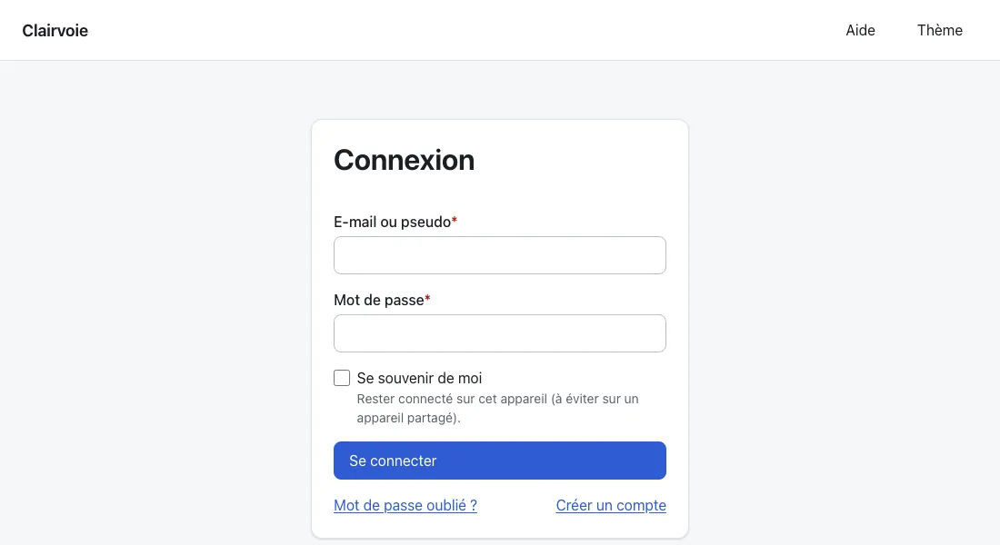
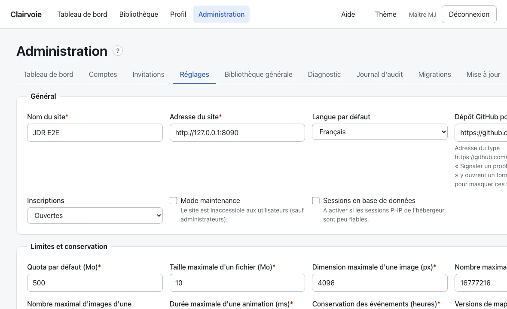
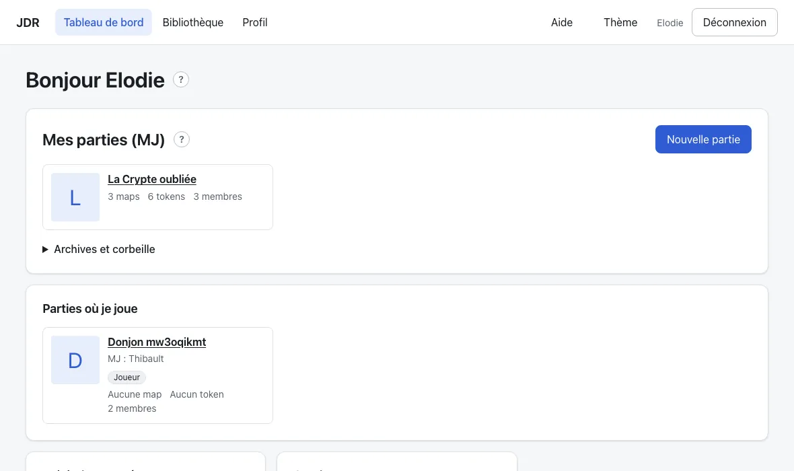
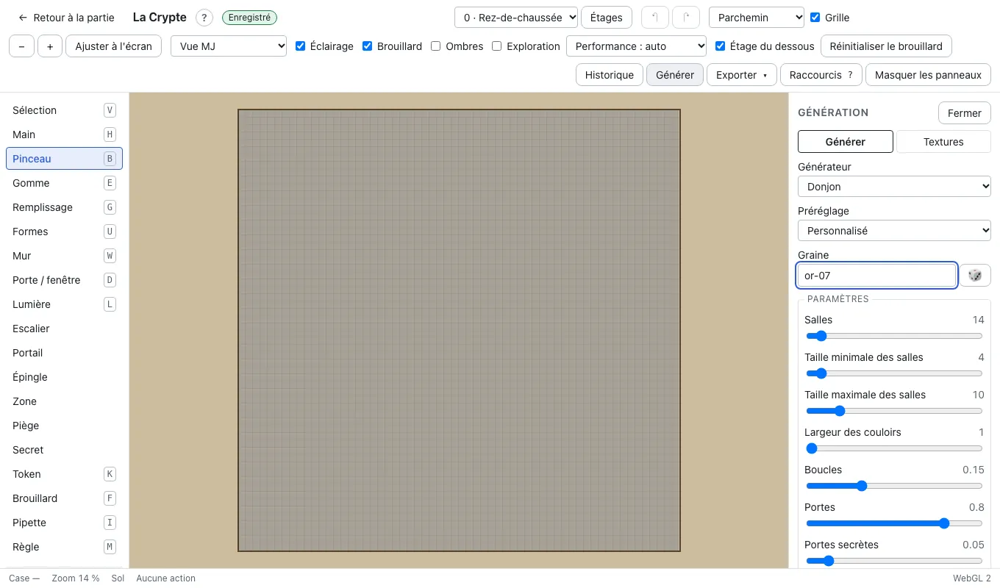
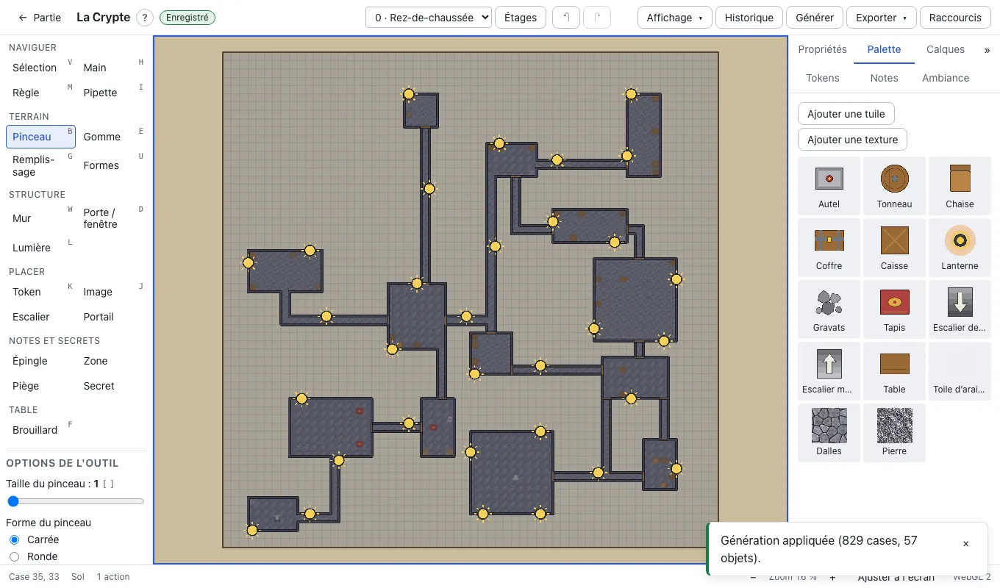
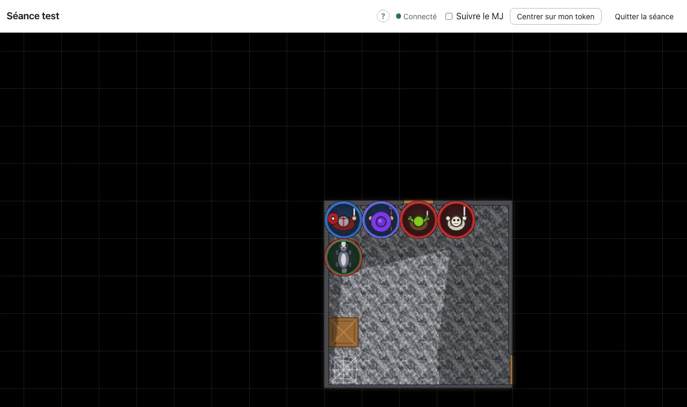
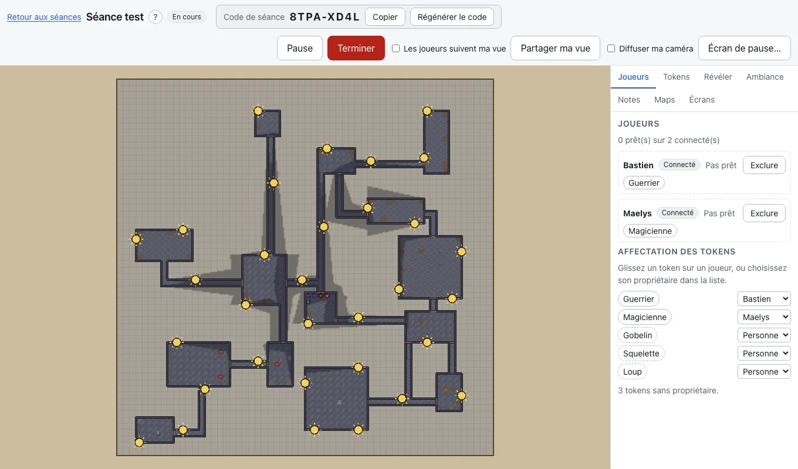
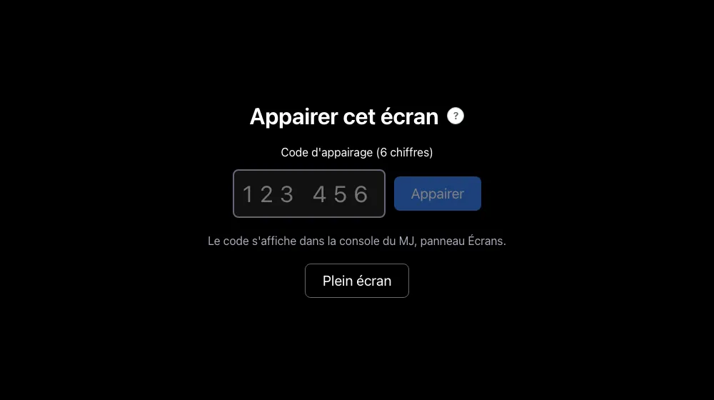

# Tutoriel : de l'installation à votre première séance

Ce guide s'adresse à un MJ qui découvre JDR et n'est pas développeur. Il suit l'ordre naturel : installer le site, le régler, préparer une partie et une map, puis jouer. Pour le détail, il renvoie vers les autres documents. L'aide intégrée du site (`/aide`) complète chaque étape.

**Sommaire**

1. [Installer le site](#1-installer-le-site)
2. [Premiers réglages (administrateur)](#2-premiers-réglages-administrateur)
3. [Créer une partie et inviter les joueurs](#3-créer-une-partie-et-inviter-les-joueurs)
4. [Créer votre première map](#4-créer-votre-première-map)
5. [Lancer la séance](#5-lancer-la-séance)
6. [Piloter la séance et la terminer](#6-piloter-la-séance-et-la-terminer)
7. [Option : projeter sur une télé](#7-option--projeter-sur-une-télé)
8. [Et ensuite](#8-et-ensuite)

## 1. Installer le site

Il faut un hébergement PHP/MySQL classique. Pas besoin de SSH ni de Composer. Vérifiez d'abord la liste des [prérequis](prerequis.md).

1. Téléchargez l'archive `jdr-vX.Y.Z-full.zip` sur la [page des releases](https://github.com/collet-david-pro/JDR/releases) et décompressez-la sur votre ordinateur.
2. Dans le panneau de votre hébergeur, créez une **base de données MySQL ou MariaDB**. Notez le serveur, le port, le nom de la base, l'utilisateur et le mot de passe.
3. Avec un client FTP, envoyez **tout le contenu** du dossier décompressé dans le dossier web (souvent `www/` ou `public_html/`). Affichez les fichiers cachés : les fichiers `.htaccess` doivent partir aussi.
4. Ouvrez `https://votre-site/install.php` et suivez les 6 étapes : prérequis, base de données, site, administrateur, installation, fin.
5. Connectez-vous avec le compte administrateur que vous venez de créer.

Pour le détail et le dépannage, voir [installation.md](installation.md). Sur un serveur YunoHost : [yunohost.md](yunohost.md).

## 2. Premiers réglages (administrateur)

Le lien **Administration** (réservé aux administrateurs) ouvre une page à onglets. Deux onglets suffisent pour démarrer.

1. Onglet **Réglages** : choisissez qui peut s'inscrire. Les inscriptions sont **ouvertes**, **sur invitation** ou **fermées**. Vérifiez aussi le nom et l'adresse du site.
2. Si vous choisissez « sur invitation », ouvrez l'onglet **Invitations** et cliquez sur **Nouvelle invitation**. Le **code** (et le lien `/invite/<code>`) est à transmettre à la personne.
3. Autre possibilité : onglet **Comptes**, **Créer un compte**. Sans mot de passe, le site donne un lien à transmettre (affiché une seule fois).
4. Si votre hébergeur n'envoie pas d'e-mails, renseignez la section **E-mail (SMTP)** des réglages. Sans cela, c'est vous qui réinitialisez les mots de passe.
5. Onglet **Diagnostic** : un contrôle de santé du serveur. Le bouton **Tester le flux temps réel** vérifie que les messages arrivent au fil de l'eau pendant les séances.

## 3. Créer une partie et inviter les joueurs

Une **partie** est une campagne : elle regroupe vos maps, vos tokens, vos joueurs et vos séances.

1. Sur le tableau de bord, cliquez sur **Nouvelle partie**.
2. Donnez un nom, et une description si vous voulez.
3. Cliquez sur **Créer la partie**. Elle s'ouvre avec cinq onglets : **Maps**, **Tokens**, **Joueurs**, **Séances** et **Réglages**.
4. Pour avoir des joueurs, ils doivent d'abord avoir un compte (lien de création de compte, invitation ou compte créé par l'administrateur).
5. Onglet **Joueurs**, **Ajouter un membre** : saisissez son pseudo ou son e-mail (le compte doit déjà exister sur le site), puis **Ajouter**. Le rôle est _Joueur_ ou _Co-MJ_.

Vous pouvez aussi sauter l'étape 5 : à la séance, le code de séance ajoute le joueur à la partie tout seul (voir l'étape 5 plus bas).

## 4. Créer votre première map

Deux voies : partir d'un modèle ou générer la map. Dans les deux cas, vous finissez dans l'éditeur.

### Créer ou générer

- **À partir d'un modèle** : onglet **Maps**, bouton **Depuis un modèle**. Choisissez un modèle livré, nommez la nouvelle map.
- **Vide, puis générée** : onglet **Maps**, bouton **Nouvelle map**. Donnez un nom, un type (**Combat** ou **Monde**), la taille en cases, puis **Créer et ouvrir l'éditeur**. Dans l'éditeur, cliquez sur **Générer** (ou **Maj+G**) : choisissez un générateur (donjon, grotte, extérieur, village) et un préréglage, regardez l'**aperçu**, puis **Appliquer**. Un seul **Ctrl+Z** annule toute la génération.

### Retoucher dans l'éditeur

Vos modifications sont **enregistrées automatiquement**. **Ctrl+Z** annule. **Tab** masque ou affiche les panneaux.

- **Terrain** : choisissez une tuile dans la palette, un calque (**Sol**, **Terrain**, **Décor**), puis un outil : pinceau (B), gomme (E), remplissage (G), formes (U).
- **Murs et portes** : outil **Mur** (W), un clic par point, double-clic pour finir. Outil **Porte / fenêtre** (D) : cliquez sur un mur. Les murs bloquent la vue, la lumière et les déplacements. Une porte peut être ouverte, verrouillée ou secrète.
- **Lumières** : outil **Lumière** (L), cliquez pour poser, glissez pour régler le rayon. Des préréglages existent (torche, lanterne, bougie…). Le panneau **Ambiance** règle l'obscurité, la teinte et l'heure.
- **Tokens** : d'abord créez-les dans l'onglet **Tokens** de la partie (le pack de base en contient une quarantaine, déjà prêts). Dans l'éditeur, outil **Token** (K), choisissez un token dans le panneau **Tokens**, puis cliquez sur une case.

## 5. Lancer la séance

1. Dans la partie, onglet **Séances**, cliquez sur **Nouvelle séance**. Donnez un nom et choisissez la **map de départ**. Une seule séance peut être ouverte à la fois.
2. Vous arrivez dans la **console** du MJ, avec un **code de séance**. Donnez-le à vos joueurs.
3. Chaque joueur ouvre son tableau de bord, saisit le code dans **Rejoindre une séance** (ou ouvre le lien `/join/` suivi du code). Il arrive dans la salle d'attente et se dit prêt.
4. Dans le panneau **Joueurs**, affectez un token à chaque joueur (glissez le token sur le joueur).
5. Cliquez sur **Lancer**.

Si un code circule trop, **Régénérer le code** invalide l'ancien.

## 6. Piloter la séance et la terminer

La console montre la map comme la voient les joueurs, avec vos outils. Les panneaux de côté sont : **Joueurs**, **Tokens**, **Révéler**, **Ambiance**, **Notes**, **Maps** et **Écrans**. **Ctrl+K** ouvre la palette de commandes.

- **Brouillard** : il se dévoile tout seul autour des tokens qui voient. Pour aider à la main, panneau **Révéler** : **Activer l'outil de brouillard**, puis **Révéler** ou **Masquer**, avec un **Pinceau** ou un **Rectangle**.
- **Révélations** : un clic sur une porte ou une lumière la bascule. Sélectionnez un objet, puis **Révéler l'objet aux joueurs**. Panneau **Tokens** : posez un token (option **Poser masqué**), masquez-le ou révélez-le.
- **Pause** : le bouton **Pause** met la séance en pause, **Reprendre** la relance. **Écran de pause…** règle le texte et l'image que les joueurs voient pendant ce temps.
- **Changer de map** : panneau **Maps**.
- **Terminer** : met fin à la séance. Les joueurs sont déconnectés et c'est définitif. Une séance terminée se consulte seulement.

## 7. Option : projeter sur une télé

Une télé posée à plat, une tablette ou un vidéoprojecteur peut afficher la map à l'échelle réelle, pour poser de vraies figurines. L'écran n'a pas de compte et ne montre que ce que tout le monde peut voir.

1. Séance lancée, console du MJ, panneau **Écrans**.
2. Saisissez un nom (« Table »…) puis **Ajouter un écran**. Un code à 6 chiffres (valable 10 minutes) et un QR code apparaissent.
3. Sur l'appareil, ouvrez l'adresse du site suivie de `/display` et saisissez le code, ou scannez le QR code.
4. L'écran passe « appairé » dans la console.

Calibrage, rotation et dépannage : [irl.md](irl.md).

## 8. Et ensuite

- **Aide intégrée** : le lien **Aide** de l'en-tête (`/aide`) décrit toutes les fonctions, avec recherche et raccourcis clavier.
- **Mises à jour** : onglet **Mise à jour** de l'administration, voir [mise-a-jour.md](mise-a-jour.md).
- **Sauvegarde** : onglet **Sauvegarde** de l'administration. Les sauvegardes ne sont pas gardées sur le serveur : téléchargez-les. Voir [sauvegarde.md](sauvegarde.md).
