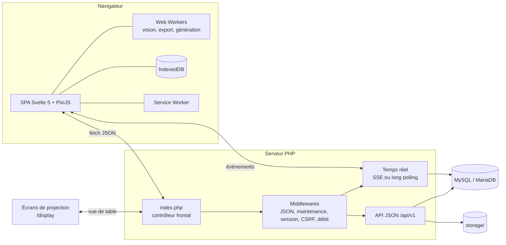

# Architecture

Document de référence unique pour les contributeurs (l'ancien `docs/architecture.md` renvoie ici). Consignes pour agents et mainteneurs : [AGENTS.md](../../AGENTS.md). Décisions : [decisions.md](decisions.md). Recettes : [recettes.md](recettes.md).

Vue d'ensemble. JDR est une SPA (Svelte 5 + PixiJS) servie par un back-end PHP sans framework, conçu pour un hébergement mutualisé : pas de démon, pas de WebSocket, pas de Composer, pas de cron garanti.

```
Navigateur : SPA Svelte 5 ── moteur de scène Pixi ── Web Workers ── IndexedDB / Service Worker
      │  fetch JSON (/api/v1)              │  SSE → long polling → polling court
PHP : index.php → Router → Middleware → Controllers → services métier → repositories (PDO)
      Realtime (journal d'événements MySQL + fichiers témoins) · Imaging · Migrate
      │                                    │
MySQL / MariaDB                      storage/ (assets, journaux, sauvegardes, cache)
```

## Arborescence

La racine du dépôt est la racine envoyée par FTP, sauf les dossiers de développement.

| Chemin | Rôle | Livré |
|---|---|---|
| `index.php` | contrôleur frontal unique (pages + API) | oui |
| `install.php`, `update.php`, `cron.php` | installeur, mise à jour, tâches planifiées (clé) | oui (`install.php` absent de l'archive de mise à jour) |
| `.htaccess` | réécriture vers `index.php` + protections | oui |
| `VERSION`, `CHANGELOG.md`, `manifest.json` | version semver, journal, SHA-256 de chaque fichier livré | oui |
| `assets/`, `sw.js` | front compilé (noms hachés) et Service Worker, générés par le build | oui (non versionnés) |
| `app/` | code PHP privé, espace de noms `JDR\` (Core, Middleware, Domain, Http, Realtime, Imaging, Maps, Migrate, Install, Mail, Views, Seed, Zip) | oui |
| `migrations/` | `NNNN_description.sql` / `.php`, jamais modifiées une fois publiées | oui |
| `i18n/` | traductions partagées PHP / front | oui |
| `storage/` | données d'exécution (assets, sauvegardes, journaux, cache, verrous) ; jamais écrasé | squelette seulement |
| `config.php` | généré par l'installeur | jamais |
| `frontend/` | sources du front (Svelte, TypeScript, Vite) | non |
| `tests/` | PHPUnit, Playwright, fichiers de test | non |
| `dev/` | scripts (serveur local, release, migrations), Docker Compose | non |
| `docs/` | documentation (`docs/dev/` pour les contributeurs) | non |

### Protection des dossiers privés

L'hébergeur ne permet pas toujours de choisir la racine web : tout ce qui est livré est donc public par défaut. `app/`, `migrations/`, `storage/` et `i18n/` sont protégés par **trois** mécanismes : un `.htaccess` (« deny all »), un `index.php` qui renvoie 403, et une garde en tête de chaque fichier PHP privé :

```php
declare(strict_types=1);
defined('JDR_BOOT') || exit;
```

L'installeur vérifie par une vraie requête HTTP que ces dossiers sont inaccessibles. Sous Nginx, voir [nginx.md](../nginx.md).

## Décisions structurantes

Le détail (contexte, décision, conséquence) est dans [decisions.md](decisions.md). En bref : PHP sans framework ni Composer, MySQL/MariaDB, Svelte 5 + PixiJS v8, Web Workers pour les calculs lourds, temps réel par journal d'événements MySQL, brouillard strict et filtrage d'audience, fichiers hors base avec URL signées, schéma par migrations seulement.

## Cycle d'une requête

`index.php` définit `JDR_BOOT`, charge `app/bootstrap.php` (autoload, configuration, gestion des erreurs, en-têtes de sécurité) et passe la main à `JDR\Core\App`, qui construit le conteneur (`Core/Container`, autowiring par type de constructeur). Le routeur (`Core/Router`) résout la route : en mode `rewrite` depuis le chemin de l'URL, en mode `query` depuis `index.php?r=/chemin`. Les routes de l'API sont déclarées dans `app/Http/routes/NN-domaine.php`, chargées par `app/Http/routes.php` dans l'ordre alphabétique, avec des options par route (`auth`, `csrf`, `rate`, `raw_body`, `maintenance_exempt`, `display`).

Chaîne : `Pipeline` de middlewares (`Json`, `Maintenance`, puis `Session`, `Auth`, `MaintenanceGate`, `Csrf`, `RateLimit`) -> contrôleur (`app/Http/Controllers`, mince : lit la requête, appelle un service, renvoie une `Response`) -> service de domaine (`app/Domain/<Domaine>`, règles métier, droits par objet) -> dépôt (`*Repository`, PDO, requêtes préparées) -> MySQL. Toute exception typée (`Core/Errors`) est convertie en réponse JSON par `ErrorHandler` :

```json
{ "ok": true,  "data": { }, "meta": { } }
{ "ok": false, "error": { "code": "…", "message": "…", "fields": { } } }
```

Les pages HTML (hors API) sont servies par `Http/Shell` : le shell de la SPA, avec le nonce CSP et les données de démarrage lues par `frontend/src/lib/boot.ts`.

## Front

SPA Svelte 5 (runes), sans SvelteKit : `frontend/src/main.ts`, `App.svelte`, `router.ts` / `routes.ts` (pages chargées en différé), `pages/` (écrans), `components/` (composants), `lib/` (logique par domaine : client d'API, sessions, réglages, aide, temps réel...), `stores/` (état global), `editor/` (éditeur de maps : contrôleur, outils, historique, synchronisation), `engine/` et `scene/` (rendu PixiJS), `vision/` (lumière et brouillard), `procgen/` (générateurs), `workers/` (vision, génération, export PNG), `export/`, `formats/`. Règle : aucun objet Pixi dans un état réactif (`$state` crée des proxys profonds). Le Service Worker (`frontend/sw/sw.ts`, construit en `sw.js`) met en cache les fichiers hachés et les URL d'assets signées, jamais l'API.

## Temps réel

Pas de WebSocket. Tout changement observable est écrit comme **événement** dans la table `events` (journal, canal `session:{id}` ou `map:{id}`, audience), dans la même transaction que le changement (`Realtime/EventStore`). Après validation, `ChannelSignal` réécrit un fichier témoin `storage/cache/ch/<sha1(canal)>` (et APCu si présent) : les boucles d'attente n'interrogent MySQL que si le témoin a changé, plus un contrôle de sécurité périodique. Lecture : `EventReader` filtre par audience du demandeur (`Audience`, `ChannelAuthorizer`). Transports, du meilleur au plus compatible, choisis par le client (`frontend/src/lib/realtime`) :

1. SSE (`GET /api/v1/stream`, `SseStream`) ;
2. long polling (`GET /api/v1/events?wait=20`, `LongPoll`) ;
3. polling court (`wait=0`).

`WaitSlots` plafonne les requêtes qui gardent un worker PHP (réglage `realtime_max_waiting`). Un seul flux par navigateur (onglet leader par Web Locks, relais `BroadcastChannel`). Un `since` trop ancien renvoie `410 events_gone` : le client recharge l'instantané (`/sessions/{id}/snapshot`). Détail : [../realtime.md](../realtime.md).

## Tâches de fond

- **Cron** (`Core/Cron`) : `cron.php?key=<cron_key>` (clé dans `config.php`) exécute les tâches de ménage (purge des événements, limites de débit, corbeilles, versions de maps, journaux, sauvegardes anciennes...), l'installation du pack d'images de base et la mise à jour automatique.
- **Pseudo-cron** : sans cron réel, `Cron::maybeRunPseudo` s'exécute après l'envoi de la réponse, avec une probabilité de 2 % par requête et un budget de 2 s, sous verrou.
- **Jobs découpés** (`Domain/Jobs`) : les travaux longs (sauvegarde, restauration, import/export de packs) sont des lignes de `background_jobs` exécutées par tranches de quelques secondes, déclenchées par le navigateur de l'administrateur (barre de progression) ; `JobRunner::HANDLERS` associe un type à son `JobHandler`.

## Installeur

`install.php` (`app/Install`, fonctionne sans JavaScript) : contrôle des prérequis (`Requirements`, `Probe`), test des dossiers privés par vraie requête HTTP, saisie de la base (`DatabaseStep`), migrations (même moteur que la mise à jour, `app/Migrate`), compte administrateur, écriture de `config.php` (`ConfigWriter`, ou contenu à copier si le fichier n'est pas inscriptible). `Install/Guard` détecte une installation existante (`config.php` ou `storage/install.lock`) et ferme l'installeur.

## Mise à jour

Deux entrées : l'administration (envoi de l'archive, vérification automatique, mise à jour automatique) et `update.php` (assistant, fichiers envoyés par FTP). `update.php` reste lisible par un PHP ancien pour pouvoir expliquer un problème ; tout le reste est dans `app/Domain/Update/`. `UpdateRunner` applique une machine à états persistée dans `storage/updates/<id>/state.json`, reprenable après interruption : vérification du paquet et de la signature Ed25519 (`ReleaseSignature`), maintenance, sauvegarde de la base et des fichiers, copie, contrôle avec `manifest.json`, migrations, fin.

## Aide intégrée

La page publique `/aide` (route `help`, accès `public`, chargée en différé) vit dans le front :

- **Contenu** : `frontend/src/help/<public>/NN-nom.md` (`joueur`, `mj`, `irl`, `admin`). Le titre est la ligne `# …` ; l'ancre stable est `<public>-<nom>` (le préfixe `NN-` fixe l'ordre seulement). Un lien interne s'écrit `[texte](#mj-creer-une-map)`, une capture ``.
- **Code** : `frontend/src/lib/help/` (rendu Markdown sûr, catalogue, recherche insensible aux accents, liens) et `frontend/src/pages/Help.svelte`. La section « Raccourcis clavier » est lue dans `editor/shortcuts.ts`. Les liens « ? » des écrans utilisent `components/HelpLink.svelte` (ancre vérifiée par `tests/help-catalog.test.ts`).
- **Adresses** : `/aide?s=<ancre>` (marche aussi en mode `query`) ou `/aide#<ancre>` (mode `rewrite`).
- **Captures** : `frontend/src/help/img/` (WebP). Pour les régénérer, après `cd frontend && npm run build` : `cd e2e && E2E_HELP_SHOTS=1 E2E_BROWSERS=chromium npx playwright test --project=help-shots` (script `e2e/shots/help-shots.ts`, thème clair, données de démonstration créées par le script). Elles servent aussi au README.

## Migrations et mises à jour

- Chaque migration appliquée est enregistrée avec son empreinte SHA-256 ; une empreinte modifiée bloque la mise à jour. La CI refuse toute modification d'une migration déjà publiée.
- Les migrations sont rejouables (le DDL MySQL n'est pas transactionnel) et appliquées une par requête pour tenir dans `max_execution_time`.
- `update.php` contrôle d'abord les fichiers envoyés avec `manifest.json`, sauvegarde la base, active la maintenance, puis migre.

## Livraison

`dev/release.mjs` calcule `manifest.json` et produit les archives `jdr-vX.Y.Z-full.zip` (installation) et `jdr-update-vX.Y.Z.zip` (mise à jour, sans `install.php` ni `storage/`). Procédure complète : [AGENTS.md](../../AGENTS.md) ; environnement local : [dev/README.md](../../dev/README.md).

## Vue d'ensemble (reprise du README)

### Ce que l'outil n'est pas

Clairvoie n'est **pas un VTT de règles** : pas de dés, pas d'initiative, pas de fiches de personnage, pas de points de vie. L'outil sert à la carte, pas aux règles.


### Principes


- **Hébergement simple** : PHP et MySQL ou MariaDB, sans démon, sans WebSocket, sans Composer en production. On envoie les fichiers, puis on ouvre `install.php`.
- **Données chez soi** : les comptes, les maps et les images restent sur votre hébergement.
- **Édition hors ligne** : l'éditeur fonctionne sans connexion, les modifications sont mises en file d'attente puis synchronisées.
- **Projection en présentiel** : des écrans sans compte, appairés à la séance, affichent la vue de table à l'échelle réelle.


### Schéma



Le back-end PHP n'utilise ni framework ni Composer en production. Le front est une SPA sans SvelteKit. Les décisions structurantes (base, rendu, temps réel, brouillard strict, fichiers signés, migrations) sont dans [decisions.md](decisions.md).


### Technologies

| Domaine | Choix |
|---|---|
| Serveur | PHP 8.1 ou plus, sans dépendance externe ; MySQL ou MariaDB |
| Interface | Svelte 5.57, TypeScript 5.9, Vite 8 |
| Rendu des maps | PixiJS 8.22 (WebGPU, repli WebGL2) |
| Calculs lourds | Web Workers (vision, export, génération) |
| Hors ligne | IndexedDB, Service Worker |
| Tests | PHPUnit 10, Vitest 4, Playwright 1.64 (Chromium, Firefox, WebKit) |


### Feuille de route

| Phase | Contenu | État |
|---|---|---|
| P0 | Fondations : routeur, base, migrations, sécurité, build, outillage | Terminée |
| P1 | Installeur, comptes, administration | Terminée |
| P2 | Bibliothèque d'images et quotas | Terminée |
| P3 | Parties, membres, tokens, rencontres | Terminée |
| P4 | Éditeur de maps : moteur, outils, hors ligne, versions, import et export, PNG | Terminée |
| P5 | Murs, portes, fenêtres, lumières, vision, brouillard de guerre | Terminée |
| P6 | Séances en temps réel : code de séance, lobby, synchronisation | Terminée |
| P7 | Mode présentiel : écrans appairés, échelle réelle | Terminée |
| P8 | Génération procédurale : donjons, grottes, extérieurs, villages, textures | Terminée |
| P9 | MJ en séance : étages et escaliers, liens entre maps, notes et épingles du MJ, zones de texte à lire, secrets et pièges, modèles de maps, palette de commandes (Cmd/Ctrl+K) | Terminée |
| P10 | Durcissement : revue de sécurité OWASP, accessibilité, performances et tests de charge, mise à jour automatique avec archives signées, sauvegarde et restauration, documentation d'exploitation | Terminée (0.3.0) |
| P11 | Grille hexagonale (option) | Abandonnée |
| P12 | Ajouts et retours d'expérience : demandes et défauts remontés à l'usage | À venir |
| P13 | Tutoriels : aide intégrée au site et tutoriel | À venir |

Le module de mise à jour (voir [Mise à jour](../mise-a-jour.md)) est livré dans la version `0.1.0-alpha.1`.

Retirés du projet : traduction anglaise, co-édition en direct, carte du monde, WebSocket.


### Dernière vérification enregistrée (reprise du README)

Dernière vérification (2026-11-02) : PHPUnit, 1113 tests ; Vitest, 1430 tests ; Playwright sur Chromium, Firefox et WebKit, partiel (écrans touchés) : 101 tests sur 102, l'échec restant étant un aléa déjà présent avant ces changements (bascule en long polling sur WebKit). L'intégration continue GitHub Actions est en pause pendant l'alpha : les tests sont lancés en local.
